## Capítulo V: Product Implementation, Validation & Deployment

### 5.1. Software Configuration Management

#### 5.1.1. Software Development Environment Configuration

Para establecer el entorno de desarrollo del software, se han seleccionado diferentes herramientas, plataformas y guías de trabajo. La siguiente tabla muestra cada recurso utilizado, junto con la finalidad que cumple dentro del proyecto y el medio mediante el cual se puede acceder a este.

| Proceso | Recurso o plataforma | Finalidad | Medio de acceso o Enlace |
|---------|----------------------|-----------|--------------------------|
|Especificación de requisitos|Convenciones Gherkin|Definir condiciones de aceptación y criterios funcionales de manera clara y precisa| [Guía Gherkin](https://cucumber.io/docs/gherkin/)
|Desarrollo Landing Page| Visual Studio Code | Desarrollar, modificar y optimizar el código fuente de la aplicación web|[Visual Studio Code](https://code.visualstudio.com/)|
|Administrador de versiones| Git | Controlar las modificaciones realizadas y administrar las diferentes versiones del proyecto|[Git](https://git-scm.com/)|
|Diseño de experiencia e interfaz| Figma | Elaborar prototipos y organizar visualmente la interfaz de usuario|[Figma](https://figma.com)|
|Publicación y despliegue| Github Pages | Publicar y alojar la página web para permitir su acceso en línea|[Github Pages](https://pages.github.com/)|
|Planificación y gestión del proyecto| Jira Software | Administrar el Product Backlog, planificar los Sprints y realizar el seguimiento de las actividades mediante una metodología ágil|[Jira](https://www.atlassian.com/es/software/jira)|
|Diagramas| PlantUML | Crear representaciones UML relacionadas con la estructura y funcionamiento del sistema|[PlantUML](https://plantuml.com/)|
|Modelado de procesos| UXPressia | Desarrollar herramientas de análisis UX enfocadas en las necesidades y experiencia del usuario|[UXPressia](https://uxpressia.com/)|

#### 5.1.2. Source Code Management

El control del código fuente se realizará mediante GitHub, utilizado como repositorio central para almacenar el proyecto y facilitar el trabajo colaborativo. Además de permitir que los integrantes trabajen sobre una misma base de código, esta plataforma proporciona un historial de las modificaciones realizadas, lo que permite identificar los cambios efectuados durante el desarrollo y mantener su trazabilidad.

Para organizar el proceso de desarrollo, el equipo ha establecido un flujo de trabajo que combina elementos de Git Flow con prácticas de GitHub Flow. Esta organización busca separar adecuadamente el desarrollo de nuevas funcionalidades, la integración de cambios y la gestión de versiones estables, permitiendo que el proyecto pueda incorporar progresivamente nuevas características sin perder el control sobre el código existente.

La estrategia de ramas definida para el proyecto se distribuye de la siguiente manera:

**main:** mantiene la versión estable del sistema que está preparada para ser desplegada.<br>
**develop:** funciona como rama de integración de los avances antes de incorporarlos a la versión estable.<br>
**feature/:** se emplea para desarrollar funcionalidades nuevas o realizar mejoras específicas.<br>
**hotfix/:** se utiliza para solucionar problemas urgentes encontrados en la versión desplegada.

El desarrollo de una nueva funcionalidad comienza creando una rama independiente a partir de develop. Esta forma de trabajo permite que cada modificación sea desarrollada de manera aislada, reduciendo la posibilidad de afectar otras partes del proyecto mientras se encuentra en proceso de implementación.

Una vez que la funcionalidad o corrección ha sido completada, el resultado se incorpora mediante un Pull Request. Antes de realizar la fusión, los demás integrantes pueden revisar los cambios efectuados. De esta manera, la integración no depende únicamente del desarrollador que realizó la modificación, sino que también incorpora una instancia de revisión colaborativa.

**Convención para los commits**

Como complemento al manejo de ramas, se utilizará Conventional Commits para mantener una estructura uniforme en los mensajes de confirmación. Esto permite reconocer rápidamente qué tipo de modificación se realizó y facilita la consulta posterior del historial del proyecto.

Los prefijos considerados son:

| Prefijo | Uso |
|---------|-----|
| **feat** | Incorporación de una nueva funcionalidad. |
| **fix** | Corrección de un error existente. |
| **docs** | Actualización o modificación de documentación. |
| **refactor** | Reorganización o mejora interna del código sin modificar su funcionalidad. |
| **style** | Cambios relacionados con el formato o estilo del código. |
| **test** | Creación o modificación de pruebas. |

**Esquema de versionado**

El proyecto también empleará Semantic Versioning, representado mediante el formato MAJOR.MINOR.PATCH. Este mecanismo permitirá identificar de forma ordenada la evolución de las versiones y diferenciar los cambios realizados según su impacto sobre el sistema.

En conjunto, el uso de GitHub, la estrategia de ramas, los Pull Requests, Conventional Commits y Semantic Versioning proporciona una estructura de trabajo que facilita el control de las modificaciones y la colaboración entre los integrantes. Asimismo, estas prácticas contribuyen a que el código pueda mantenerse y ampliarse de forma organizada durante las siguientes iteraciones del proyecto.

#### 5.1.3. Source Code Style Guide & Conventions
Para evitar diferencias innecesarias en la forma de desarrollar los distintos componentes del sistema, se establecen criterios comunes de programación. Estas reglas serán aplicadas a los lenguajes empleados en el proyecto: HTML, CSS, JavaScript y C#.

Una de las reglas generales consiste en utilizar el inglés para nombrar variables, clases, archivos, comentarios técnicos y elementos de la documentación interna. Con ello se busca mantener una nomenclatura uniforme y facilitar la comprensión del código independientemente del integrante que lo revise o modifique.

Las convenciones adoptadas toman como referencia buenas prácticas provenientes de Google Style Guides, MDN JavaScript, MDN JavaScript Guidelines y Microsoft C# Coding Conventions. También se consideran criterios relacionados con la accesibilidad y la legibilidad del código.

**HTML**

La construcción de la interfaz se realizará mediante HTML5 semántico, buscando que los elementos del documento tengan una organización lógica y que el contenido sea accesible.

Para ello, se tendrán en cuenta las siguientes reglas:

+ Las secciones principales utilizarán etiquetas semánticas como &lt;header&gt;, &lt;nav&gt;, &lt;main&gt;, &lt;section&gt;, &lt;article&gt; y &lt;footer&gt;.
+ Las etiquetas y atributos HTML se escribirán en minúsculas.
+ Todas las etiquetas deberán cerrarse correctamente.
+ Las imágenes incluirán el atributo alt para proporcionar información alternativa y favorecer la accesibilidad.
+ Cuando corresponda, las imágenes definirán sus dimensiones mediante width y height.
+ El documento HTML establecerá lang="en" en la etiqueta &lt;html&gt;.
+ Se incluirán elementos básicos de metadatos, entre ellos &lt;title&gt; y &lt;meta name="descripcion"&gt;.
+ Se evitará incorporar estilos y scripts directamente dentro del HTML cuando no sea necesario.

Ejemplo:
```HTML
<section class="hero-banner">
    
</section>
```

**CSS**

Los estilos estarán organizados de manera modular, procurando que puedan reutilizarse y mantenerse con facilidad. Para la nomenclatura de las clases se utilizará kebab-case y se aplicará la metodología BEM (Block Element Modifier) para establecer una estructura coherente.

También se seguirán estos criterios:

+ Utilizar nombres de clases descriptivos.
+ Organizar las propiedades CSS siguiendo una secuencia lógica relacionada con el layout, box model, tipografía y apariencia visual.
+ Priorizar unidades relativas como rem, %, vh y vw.
+ No especificar unidades cuando el valor establecido sea cero.
+ Diseñar bajo un enfoque mobile-first para facilitar la adaptación a diferentes tamaños de pantalla.
+ Centralizar las variables reutilizables dentro de :root.

Ejemplo: 

```CSS
:root{ 
--primary-color: #2563eb; 
--secondary-color: #64748b; 
} 
.main-header{ 
    padding: 1rem; 
    background-color: var(--primary-color); 
}
```

**JavaScript**

En el caso de JavaScript, las convenciones estarán orientadas a mantener una estructura clara y facilitar la reutilización y modificación del código.

Se aplicarán las siguientes reglas:

+ Las variables y funciones utilizarán camelCase.
+ Las clases y constructores utilizarán PascalCase.
+ Para declarar variables se emplearán const y let, evitando var.
+ Las funcionalidades se distribuirán en archivos independientes de acuerdo con su responsabilidad.
+ Los eventos se gestionarán mediante addEventListener() en lugar de utilizar eventos directamente en el HTML.
+ Los comentarios se reservarán principalmente para explicar fragmentos cuya lógica sea compleja o poco evidente.
+ Los nombres de las funciones deberán describir la acción que realizan.

Ejemplo:

```JavaScript
const submitButton = document.querySelector("#submit-button"); 
function validateForm(){ 
    return true; 
}
```

**C#**

Para los componentes relacionados con el backend y la lógica de negocio se seguirán las convenciones recomendadas para C# por Microsoft.

Entre los principales criterios se encuentran:

+ Aplicar PascalCase a clases, métodos y propiedades.
+ Utilizar camelCase para variables locales y parámetros.
+ Nombrar los métodos mediante expresiones descriptivas que representen acciones.
+ Considerar el principio Single Responsibility Principle (SRP) para distribuir adecuadamente las responsabilidades.
+ Evitar líneas excesivamente extensas para facilitar la lectura.
+ Incorporar comentarios breves en métodos críticos cuando sea necesario.
+ Organizar los componentes utilizando las capas controllers, services, repositories y models.

Ejemplo:
```C#
public class UserService { 
    public bool ValidateCredentials(string userEmail, string password) { 
        return true; 
        } 
    }
```

**Gherkin**

Para expresar los criterios de aceptación y estructurar las pruebas funcionales se empleará Gherkin. Su utilización permitirá describir el comportamiento esperado del sistema mediante una estructura comprensible tanto para los integrantes técnicos como para los stakeholders.

Los escenarios deberán cumplir con las siguientes condiciones:

Seguir la estructura Given-When-Then.
Utilizar un lenguaje comprensible para personas sin conocimientos técnicos.
Contar con títulos específicos que permitan identificar fácilmente el escenario.
Emplear Scenario Outline cuando sea necesario representar diferentes casos que mantengan una estructura similar.

Ejemplo:

```gherkin
Feature: User Login 
Scenario: Sucessful login 
    Given the user is on the login page 
    When the user enters valid credential 
    Then the system should redirect to the dashboard
```

**Principios generales de codificación**

Además de las reglas específicas para cada lenguaje, el desarrollo se orientará mediante cinco principios generales:

+ Readability First: priorizar que el código pueda entenderse fácilmente.
+ Consistency: conservar criterios de desarrollo uniformes en toda la solución.
+ Modularity: separar las responsabilidades en módulos claramente definidos.
+ Scalability: mantener una estructura que pueda soportar el crecimiento futuro del sistema.
+ Maintainability: facilitar la corrección, modificación y evolución del código.

#### 5.1.4. Software Deployment Configuration

**Despliegue de la Landing Page**

La Landing Page será desarrollada utilizando HTML, CSS y JavaScript y posteriormente publicada mediante GitHub Pages. Para ello, primero será necesario mantener correctamente organizados los archivos dentro del repositorio remoto.

**Organización del repositorio**

El archivo index.html deberá encontrarse directamente en la raíz del repositorio, debido a que será utilizado como archivo inicial durante el proceso de publicación. Los recursos complementarios se distribuirán en carpetas independientes según su función, permitiendo diferenciar los estilos, scripts e imágenes y facilitando el mantenimiento posterior.

La estructura prevista será la siguiente:

```
/ 
|---index.html 
|---css/ 
|   |__ styles.css 
|---js/ 
|  |__ main.js 
|---assets/ 
|       |__ images/
```
**Configuración de GitHub Pages**

Una vez que los archivos se encuentren disponibles en el repositorio, se configurará GitHub Pages como servicio de publicación de la Landing Page.

La configuración contempla las siguientes acciones:

1. Acceder al repositorio del proyecto en GitHub.
2. Ingresar a Settings.
3. Seleccionar la sección Pages.
4. Establecer la rama main como fuente de publicación.
5. Seleccionar la carpeta raíz /root como directorio de despliegue.
6. Guardar la configuración.

Después de completar la configuración, GitHub realizará automáticamente el proceso necesario para generar y publicar el sitio.

**Acceso a la versión publicada**

Cuando el despliegue haya finalizado, GitHub proporcionará una dirección pública desde la cual será posible acceder a la Landing Page.

La estructura esperada de la dirección será:

```
https://<usernanme>.github.io/<repository-name>/
```

Esta dirección corresponderá al acceso público de la versión oficial del producto.

**Actualización del sitio**

El proceso de despliegue también contempla las futuras modificaciones realizadas por el equipo. Cada cambio efectuado en la Landing Page deberá registrarse mediante un nuevo commit y enviarse al repositorio.

Cuando los cambios sean incorporados a la rama principal, GitHub Pages actualizará automáticamente el contenido publicado. Así, la versión disponible en línea podrá mantenerse sincronizada con la versión estable más reciente del código fuente.


### 5.2. Landing Page, Services & Applications Implementation

#### 5.2.1. Sprint 1

##### 5.2.1.1. Sprint Planning 1
Para este primer Sprint, el equipo estableció como objetivo principal la implementación y despliegue de la primera versión de la Landing Page.

| Campo | Detalle |
|-------|---------|
| Sprint # | Sprint 1 |
| Date | 2026-09-06 |
| Time | 05:00 PM |
| Location | Reunión virtual vía Google Meet |
| Prepared By | Pillaca Gonzales, Andy Saúl |
| Attendees | Justo Yauricasa, Alexander Paolo / Pillaca Gonzales, Andy Saúl /Alvarado Millan, Boris / Martinez Ramos, Bryan Felix / Nawrocki Loureiro, Ian Andre |
| Sprint N-1 Review Summary | Dado que este es el Sprint inicial del proyecto, no se cuenta con un ciclo anterior para revisión. En consecuencia, la implementación del producto comienza formalmente desde sus cimientos. |
| Sprint N-1 Retrospective Summary | Al tratarse de la iteración inicial, no se cuenta con un proceso de retrospectiva previo. No obstante, el equipo estableció el compromiso de asegurar una comunicación fluida y acatar los plazos previstos. |
| Sprint 1 Goal | Nos enfocamos en el desarrollo y lanzamiento de la primera versión de la Landing Page, orientada a comunicar nuestra propuesta de valor: mejorar la seguridad y monitorieo en el transporte público. Consideramos que transmite con claridad los beneficios del sistema a potenciales clientes, lo cual se validará cuando el sitio esté en línea, cuente con todas las secciones clave y permita una navegación fluida. |
| Sprint N Velocity | 09 |
| Sum of Story Points | 09 |

##### 5.2.1.2. Aspect Leaders and Collaborators

| Team Member | GitHub Username | Configuración del Repositorio y CI/CD (L/C) | Estructura Base del Landing Page (L/C) | Funcionalidades Interactivas (L/C) | Corrección de Contenido (L/C) |
|------------|-----------------|---------------------------------------------|----------------------------------------|-----------------------------------|-------------------------------|
| Alvarado Millan, Boris | borisalvaradomillanPE | L | C | C | C |
| Justo Yauricasa, Alexander Paolo | AlexanderrJusto | C | C | C | L |
| Martinez Ramos, Bryan Felix | BryanMR1 | C | L | L | C |
| Pillaca Gonzales, Andy Saúl | apillacag | C | C | C | L |
| Nawrocki Loureiro, Ian Andre | IanNaw | C | C | C | L |

##### 5.2.1.3. Sprint Backlog 1
Se presenta el desglose tecnico de las historias seleccionadas para esta iteracion inicial. El proposito prioritario del Sprint abarca el despliegue de la pagina de aterrizaje y el cimiento de la arquitectura tecnologica del proyecto. Seguidamente, se incluye la imagen del tablero de Trello y la tabla de estados correspondiente a los elementos de trabajo.

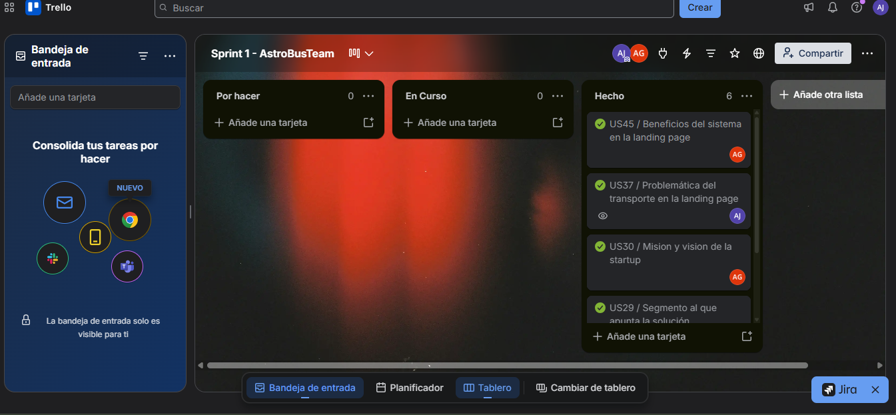

link: https://trello.com/invite/b/6aada76451c89821aa1c576d/ATTI9ede0c7d6fa24ae911466aeadaa1cec5C94715BC/sprint-1-astrobusteam 

| Sprint # | Sprint 1 | | | | | | |
|----------|----------|-|-|-|-|-|-|
| **User Story** | | **Work-item / Task** | | | | | |
| Story Id | Story Title | Task Id | Task Title | Task Description | Estimation (Hours) | Assigned To | Status (To-do / In-Process / To-Review / Done) |
| US29 | Segmento al que apunta la solución | T-01 | Segmento al que apunta | Mostramos a como y andonde apunta nuestro sistema. | 2 | Alvarado Millan, Boris | Done |
| US37 | Problemática del transporte en la landing page | T-02 | Problematica | Mostrar la desbentajas del traspodte publico sin nuestro aplicacativo. | 2 | Justo Yauricasa, Alexander Paolo | Done |
| US38 | Propuesta de valor en la landing page | T-03 | Propuesta de valor | Mostrar los valores que tiene nuestra aplicativo en el trasporte publico. | 1 | Martinez Ramos, Bryan Felix | Done |
| US45 | Beneficios del sistema en la landing page | T-04 | Beneficios | Mostrar los beneficios que tiene nuestra aplicativo en el trasporte publico. | 1 | Pillaca Gonzales, Andy Saúl | Done |
| US46 | Equipo detrás de la solución | T-05 | Equipo | Mostramos las soluciones que tene nuestro aplicatico en el traspote publico | 2 | Nawrocki Loureiro, Ian Andre | Done |
| US30 | Mision y vision de la startup | T-06 | Mision y vision | Mostromos la vision y mision en la Landing Page. | 1 | Pillaca Gonzales, Andy Saúl | Done |


##### 5.2.1.4. Development Evidence for Sprint Review

En este primer Sprint el equipo implementó la landing page. Todo el trabajo se desarrolló sobre ramas feature/* que se integraron a develop mediante Pull Requests revisados. A continuación se listan los commits más representativos del sprint.

| Repository | Branch | Commit Id | Commit Message | Commit Message Body | Commited on (Date) |
| :--- | :--- | :--- | :--- | :--- | :--- |
| SecurityBus-730-AW | feature/00-chapter-01 | ce1b67ea7c64e009aa307b91b9498b2e4d3211fd | docs: Merge chapter 1 | Merge branch 'feature/00-chapter-01' of https://github.com/AstroBusTeam/SecurityBus-730-AW into feature/00-chapter-01 | 10/09/2026 |
| SecurityBus-730-AW | feature/10-chapter-02 | e4c0da51c90fd37c8a59aa353c58aa894d881e12 | fix: fix a litle problem in the document | - | 11/09/2026 |
| SecurityBus-730-AW | feature/chapter-3 | 0e8fbc867149f98f4a5e1b9058293ccb81b53b93 | docs: Merge chapter 3 | Merge branch 'feature/chapter-3' into develop| 10/09/2026 |
| SecurityBus-730-AW | feature/chapter-04 | 9063bdf2ee33ae22be820af08c69f8ebb2443b58 | Docs: Create Event Storming | -| 10/09/2026 |
| SecurityBus-730-AW | feature/chapter-05 | 8d75682360fd891997329ce480af8349b238b4a8 | Docs:Event Storming folder created | -| 11/09/2026 |

##### 5.2.1.5. Execution Evidence for Sprint Review

Durante el primer Sprint, la prioridad del equipo fue la implementación y el lanzamiento de la primera versión de la página. El propósito central fue posicionar la propuesta de valor en materia de seguridad para el transporte público mediante una estructura que abarca desde la presentación general y los beneficios, hasta testimonios, funcionalidades clave y canales de contacto. 

La Landing Page incluye las siguientes secciones:

- **Hero:** Sección inicial que presenta el mensaje principal "Protege tu ruta, asegura tu futuro" e incorpora los accesos "Empezar ahora" y "Ver características" para orientar al usuario hacia las principales opciones de la plataforma.


- **Caracteristicas:** Presenta las funciones principales de SecurityBus, como la validación del conductor mediante código QR, el botón de pánico para situaciones de emergencia, el control de pasajeros a bordo y el seguimiento de la unidad durante el recorrido.

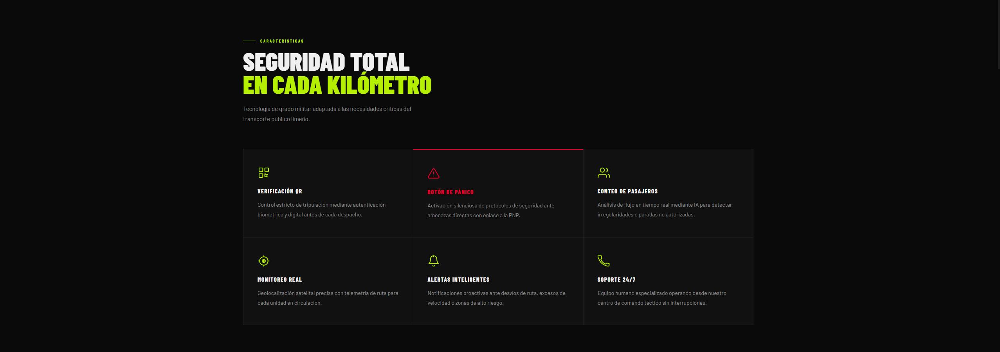

- **Funcionalidad** Expone de forma resumida el funcionamiento de SecurityBus, abarcando desde la verificación del conductor hasta las acciones previstas ante una situación de emergencia.


- **Navegacion:** Barra de navegación que facilita el acceso a las distintas secciones disponibles en la Landing Page de SecurityBus.


- **Estadistica:** Muestra datos relevantes que permiten contextualizar los principales problemas relacionados con la seguridad en el transporte público.

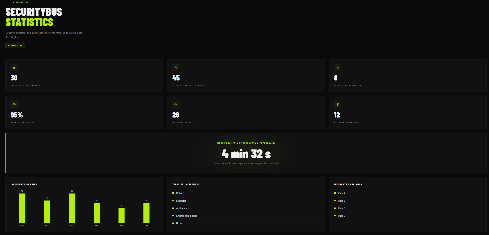

- **Interfaz:** Utiliza una apariencia moderna en modo oscuro, acompañada de elementos visuales y tonalidades contrastantes que refuerzan la identidad de SecurityBus.

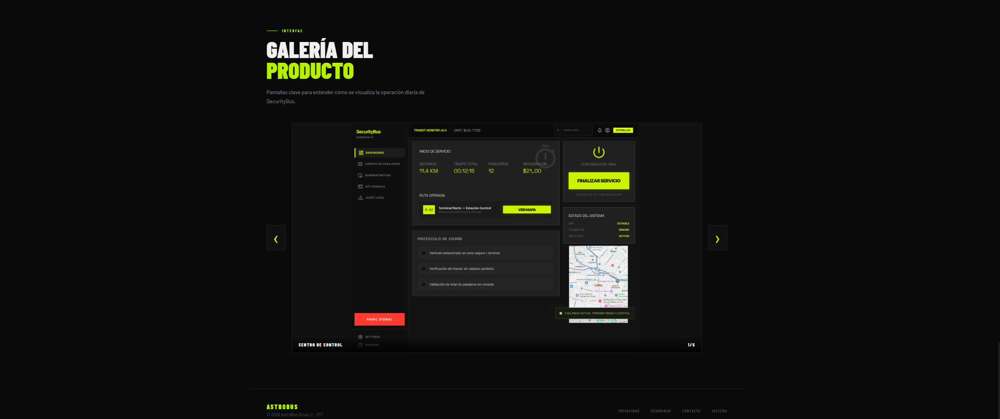

Link a la Landing Page: [SecurityBus Landing Page](https://astrobusteam.github.io/SecurityBus-landing-page-aw/)

##### 5.2.1.6. Services Documentation Evidence for Sprint Review

En el Sprint 1 de SecurityBus, el desarrollo estuvo centrado únicamente en la construcción de la Landing Page estática. Durante esta etapa no se implementaron servicios web, por lo que aún no se dispone de endpoints que requieran documentación. El desarrollo y la documentación de estos servicios se abordarán en los siguientes Sprints.

##### 5.2.1.7. Software Deployment Evidence for Sprint Review

Las funcionalidades desarrolladas durante este Sprint comprenden tanto la estructura principal de navegación como distintos elementos destinados a mejorar la experiencia del usuario en la Landing Page de SecurityBus. Para su construcción se estableció una organización basada en componentes reutilizables, un sistema de enrutamiento y estilos globales alineados con la identidad visual definida previamente para el proyecto.

El proceso de desarrollo se gestionó mediante Git Flow, utilizando ramas específicas para trabajar las diferentes funcionalidades antes de incorporarlas al proyecto mediante pull requests. Esta metodología permitió mantener una adecuada organización del código y facilitar el trabajo colaborativo entre los integrantes del equipo de AstroBus, quienes participaron en las distintas actividades relacionadas con el desarrollo front-end.

Asimismo, se realizaron ajustes orientados al diseño responsive, buscando que la Landing Page pueda visualizarse correctamente en distintos tamaños de pantalla. También se consideraron aspectos relacionados con el rendimiento y la accesibilidad web, tomando como referencia los estándares WCAG para ofrecer una interfaz más accesible a los diferentes usuarios vinculados con la propuesta de SecurityBus.

- 1: Primera funcionalidad: Implementación de la sección Hero, encargada de presentar el propósito principal de SecurityBus, acompañada de indicadores relacionados con el impacto de la propuesta y botones de llamada a la acción.
- 2: Segunda funcionalidad: Desarrollo de la sección de Características, donde se presentan las seis funcionalidades principales del sistema: Verificación QR, Botón de Pánico, Conteo de Pasajeros, Monitoreo Real, Alertas Inteligentes y Soporte 24/7.
- 3: Tercera funcionalidad: Incorporación de la sección ¿Cómo funciona SecurityBus?, en la que se explica el funcionamiento general de la propuesta mediante cuatro etapas: Inicio de Turno, Monitoreo Constante, Alerta Inmediata e Intervención.

---

### Despliegue en GitHub Pages

1. Se creó el repositorio público en la organización de GitHub del equipo SecurityBus y se subió el código fuente de la landing page construida con React + Vite.
   
2. En el repositorio. Dentro de **Pages**, como origen de publicación, se guardaron los cambios para activar la publicación automática.
   
3. Se configuraron los archivos necesarios para que los assets funcionen correctamente bajo el subdominio de GitHub Pages.
   
4. Se creó el archivo de workflow para automatizar el build y despliegue mediante GitHub Actions cada vez que se realice un push a la rama
   
5. Una vez activado el despliegue, GitHub Pages generó la URL pública del sitio desde donde cualquier usuario puede acceder a la landing page de SecurityBus sin necesidad de credenciales.
    
---

##### 5.2.1.8. Team Collaboration Insights during Sprint

Durante el Sprint 1, los integrantes del equipo AstroBus participaron de manera conjunta en el desarrollo de la Landing Page de SecurityBus, quedando sus aportes registrados mediante los commits realizados en el repositorio del proyecto. Las actividades fueron distribuidas entre los miembros del equipo, permitiendo avanzar de forma organizada en la implementación de las diferentes secciones, funcionalidades, contenido y aspectos visuales de la página.

Para administrar los cambios realizados durante el desarrollo, el equipo utilizó GitFlow como estrategia de control de versiones. El trabajo se realizó principalmente sobre la rama develop, utilizando ramas específicas para cada capitulo. 
Posteriormente, los cambios fueron integrados mediante Pull Requests, permitiendo revisar las modificaciones antes de incorporarlas a las ramas principales del proyecto.

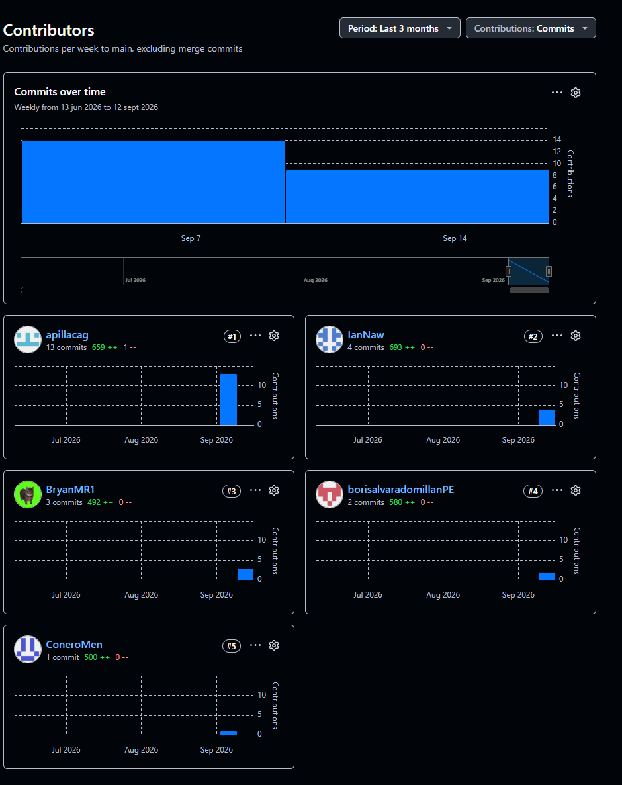


#### 5.2.2. Sprint 2

##### 5.2.2.1. Sprint Planning 2

| Sprint # | Sprint 2 |
| :--- | :--- |
| **Sprint Planning Background** | |
| Date | 27/09/2026 |
| Time | 5:30 PM |
| Location | Virtual |
| Prepared By | Justo Yauricasa, Alexander Paolo |
| Attendees (to planning meeting) | Pillaca Gonzales, Andy Saúl<br>Justo Yauricasa, Alexander Paolo |
| **Sprint 1 Review Summary** | Durante este sprint, el equipo se enfocó en el desarrollo e implementación de la interfaz de usuario (UI) de la aplicación web SecurityBus y en una Fake API RESTful que simula el backend. Se logró maquetar, diseñar e integrar la experiencia visual, que incluyó componentes interactivos, vistas de reportes, mapa de alertas, flujos de navegación y el monitoreo de velocidad de los servicios con evaluación de conducta del conductor, sentando la base frontend de la plataforma. Además, se expusieron por API los servicios técnicos de validación de conductores (TS01), apertura de servicio (TS02), emisión de alertas (TS03), actualización del conteo (TS04), consulta del estado de la unidad (TS06) y cierre de servicio (TS08), verificados con 29 pruebas sobre los siete recursos de la API|
| **Sprint 1 Retrospective Summary** | El equipo demostró una gran capacidad de ejecución para manejar el alto volumen de tareas visuales, y el uso de componentes reutilizables agilizó significativamente el desarrollo. Como punto de mejora, identificamos que en los próximos sprints debemos optimizar la coordinación entre los integrantes para el desarrollo. |
| **Sprint Goal & User Stories** | |
| **Sprint 2 Goal** | Completar el diseño y la maquetación frontend de la aplicación web SecurityBus, incluyendo el monitoreo de velocidad de los servicios, y exponer mediante una Fake API RESTful desplegada los servicios técnicos (Technical Stories) de validación de conductores, apertura y cierre de servicio, actualización del conteo de pasajeros, consulta del estado de la unidad y emisión de alertas, garantizando que las interfaces sean funcionales a nivel visual, responsivas y alineadas con la guía de estilos, y dejando el proyecto listo para la integración con los servicios del backend. |
| **Sprint 2 Velocity** | 125 |
| **Sum of Story Points** | 125 |

##### 5.2.2.2. Aspect Leaders and Collaborators

Durante el desarrollo del Sprint 2, se han identificado distintos aspectos funcionales relacionados al diseño y construcción de la aplicación web de SecurityBus. Con el objetivo de organizar el trabajo del equipo de manera eficiente, se ha elaborado una matriz de Liderazgo y Colaboración (LACX), donde se asigna a cada integrante el rol de líder (L) en los módulos clave del desarrollo que se le han asignado, y el rol de colaborador (C) en otros aspectos. 

Los aspectos definidos para este Sprint, son:

1. **Apartado de Login:** Registro e inicio de sesión.
2. **Apartado de Dashboard:** Monitoreo de distancia, tiempo, pasajeros, dinero recaudado, ruta y botón de finalizar.
3. **Gestión de flota:** Creación de conductor y buses. Además, la vinculación del conductor con el bus.
4. **Botón de alarma:** Botón que muestra el peligro de un conductor, su ubicación y su estado.
5. **Registros de alarma:** Visualización de registros de alarmas y sus estados.
6. **Mapa:** Mostrar las alertas en el mapa.
7. **Sistema de notificaciones:** Envío de alerta a los busces cercanos.
8. **Fake API y Technical Stories:** Servicios por API (TS01, TS02, TS03, TS04, TS06 y TS08) y su despliegue.

A continuación, se presenta la matriz de responsabilidades del equipo:

| Team Member (Last Name, First Name) | GitHub Username | Login | Dashboard | Fleet management | Alarm button | Alarm Logs | Map | Notification system | Fake API y TS |
| :--- | :--- | :--- | :--- | :--- | :--- | :--- | :--- | :--- | :--- |
| Justo Yauricasa, Alexander Paolo | AlexanderrJusto | L | L | L | C | C | C | C | L (conductores, turnos) |
| Pillaca Gonzales, Andy Saúl | apillacag | C | C | C | L | L | L | L | L (alertas, vehículos) | 

**Nota:** Distribución de responsabilidades de los integrantes del equipo durante el Sprint 2, indicando el liderazgo (L) y la colaboración (C) en cada funcionalidad desarrollada.

##### 5.2.2.3. Sprint Backlog 2

| User Story Id | User Story Title | Work Item/Task Id | Work Item/Task Title | Description | Estimation | Assigned To | Status |
| :--- | :--- | :--- | :--- | :--- | :--- | :--- | :--- |
| US-01 | Autenticación del conductor al iniciar la jornada | T01 | UI Autenticación Conductor | Maquetación e ingreso de código. | 3h | Alexander Justo | To Do |
| US-14 | Verificación de habilitación del conductor | T08 | Lógica Verificación Habilitación | Validación de permisos del conductor. | 3h | Alexander Justo | To Do |
| US-15 | Vínculo entre conductor y unidad | T09 | Registro Asignación Conductor | Asociación del conductor a la unidad. | 3h | Alexander Justo | To Do |
| US-02 | Apertura del registro de servicio | T02 | UI Apertura Servicio | Botón para iniciar el servicio. | 2h | Alexander Justo | To Do |
| US-03 | Envío de alerta desde la unidad | T03 | UI Botón de Alerta | Botón de pánico silencioso. | 3h | Andy Pillaca | To Do |
| US-04 | Notificación de la alerta a la central | T04 | Servicio Recepción Alerta | Envío de alerta a la central. | 4h | Andy Pillaca | To Do |
| US-42 | Ubicación asociada al evento | T20 | Captura GPS en Alerta | Captura de ubicación GPS. | 3h | Andy Pillaca | To Do |
| US-05 | Persistencia del evento de emergencia | T05 | Persistencia de Alertas | Guardado del evento de alerta. | 3h | Andy Pillaca | To Do |
| US-23 | Acuse de recepción de la alerta | T11 | Módulo Acuse de Recibo | Registro de confirmación de alerta. | 3h | Andy Pillaca | To Do |
| US-24 | Reenvío de alertas sin confirmar | T12 | Mecanismo Reintentos Alerta | Reintento de envío no confirmado. | 4h | Andy Pillaca | To Do |
| US-40 | Clasificación de alertas por gravedad | T19 | Priorización de Alertas | Asignación de nivel de prioridad. | 3h | Andy Pillaca | To Do |
| US-33 | Difusión de la alerta a varios destinatarios | T17 | Servicio Multidifusión Alertas | Envío a múltiples destinatarios. | 4h | Andy Pillaca | To Do |
| US-43 | Seguimiento de la unidad asignada | T21 | UI Mapas y Seguimiento GPS | Visualización GPS en mapa. | 5h | Andy Pillaca | To Do |
| US-06 | Conteo automático de ocupantes | T06 | Integración Sensores Pasajeros | Conteo de pasajeros a bordo. | 4h | Alexander Justo | To Do |
| US-07 | Disponibilidad del conteo para reportes | T07 | API Consulta Ocupación | Consulta del número de ocupantes. | 2h | Alexander Justo | To Do |
| US-25 | Cierre del registro de servicio | T13 | UI Cierre Servicio | Botón para finalizar el servicio. | 2h | Alexander Justo | To Do |
| US-26 | Consulta del estado del propio servicio | T14 | UI Estado de Servicio Conductor | Vista del estado actual del viaje. | 3h | Alexander Justo | To Do |
| US-27 | Tablero de estado de la flota | T15 | Dashboard Flota | Panel general de la flota. | 5h | Alexander Justo | To Do |
| US-16 | Revisión del historial de emergencias | T10 | UI Historial Emergencias | Listado de emergencias pasadas. | 4h | Andy Pillaca | To Do |
| US-28 | Seguimiento de la ocupación en operación | T16 | UI Reporte Ocupación Flota | Monitoreo del nivel de carga. | 4h | Alexander Justo | To Do |
| US-35 | Promedio de pasajeros por viaje | T18 | Cálculo Estadístico Ocupación | Cálculo promedio de pasajeros. | 3h | Alexander Justo | To Do |
| TS01 | Servicio de validación de conductores | T22 | API Validación Conductor | GET /drivers?employeeCode={código}: verifica identidad y estado del conductor. | 3h | Alexander Justo | To Do |
| TS02 | Servicio de apertura de servicio | T23 | API Apertura Servicio | POST /shifts: registra el turno y devuelve su identificador. | 3h | Alexander Justo | To Do |
| TS03 | Servicio de emisión de alertas | T24 | API Emisión Alertas | POST /alerts: registra la alerta con su ubicación y devuelve su identificador. | 3h | Andy Pillaca | To Do |
| TS04 | Servicio de actualización del conteo | T25 | API Actualización Conteo | PUT /shifts/{id}: actualiza pasajeros y velocidad del turno. | 2h | Alexander Justo | To Do |
| TS06 | Servicio de consulta del estado de la unidad | T26 | API Estado Unidad | GET /vehicles/{id}: devuelve estado y posición de la unidad. | 3h | Andy Pillaca | To Do |
| TS08 | Servicio de cierre de servicio | T27 | API Cierre Servicio | PUT /shifts/{id}: cierra el turno (estado finished) y registra su hora de término. | 2h | Alexander Justo | To Do |


**Nota:** Relación entre las historias de usuario y las Technical Stories (TS) del Sprint 2 y las tareas planificadas para su implementación incluyendo su estimación, responsable asignado y estado de ejecución

##### 5.2.2.4. Development Evidence for Sprint Review

En este segundo Sprint hemos realizado la implementación del frontend, donde todo el equipo ha aportado mediante la gestión de ramas. En la siguiente tabla se muestran los commits realizados.

| Repository | Branch | Commit Id | Commit Message | Commit Message Body | Commited on (Date) |
| :--- | :--- | :--- | :--- | :--- | :--- |
| AstroBusTeam-FrontEnd | feature/iam | 2317a3abf7b753f4b52e65aed1632721b0c10258 | feature: add iam | -- | [06/10/2026] |
| AstroBusTeam-FrontEnd | feature/fleet | b4b01276395f339487e1b7b3fdb1e36e9536ef05 | feature: create the fleet component and functions | -- | [06/10/2026] |
| AstroBusTeam-FrontEnd | feature/operations | 830f93a480adb5f957ff975f007e2058a0b2fd88 | Merge pull request #3 from AstroBusTeam/feature/operations | -- | [06/10/2026] |
| AstroBusTeam-FrontEnd | feature/alerts | 5c51e4912c9308f6e14fa750d7a1e1316efe779d | Merge pull request #2 from AstroBusTeam/feature/alerts | -- | [06/10/2026] |
| AstroBusTeam-FrontEnd | feature/shared | 0a53309b6b74c59fb78f26beb44be9cb3cff9339 | Merge pull request #1 from AstroBusTeam/feature/shared | -- | [06/10/2026] |

##### 5.2.2.5. Execution Evidence for Sprint Review

En este Sprint se logró la primera versión funcional de la Web Application de SecurityBus. La aplicación permite que el conductor ingrese con su código de empleado, inicie y cierre su servicio, vea el mapa de su unidad y emita una alerta de emergencia con un solo botón. Del lado de la empresa, permite supervisar la flota desde el centro de control, administrar conductores, vehículos y asignaciones, revisar las alertas y consultar los destinatarios notificados. La interfaz está disponible en español e inglés mediante el selector de idioma del toolbar y se adapta a distintos tamaños de pantalla.

Verificación de identidad del conductor. El conductor ingresa su código de empleado (por ejemplo, SF-90210). El sistema valida que el conductor esté habilitado y tenga una asignación activa, y luego lo redirige al dashboard. Las demás rutas quedan protegidas si no existe una sesión.

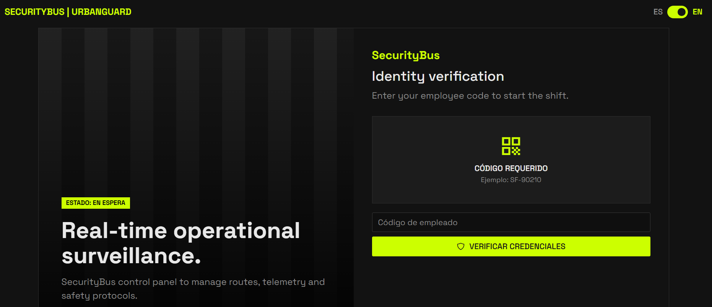

Dashboard e inicio de servicio. Muestra la unidad y la ruta asignadas, permite iniciar el servicio y, al finalizar el turno, presenta el protocolo de cierre y el resumen del turno.

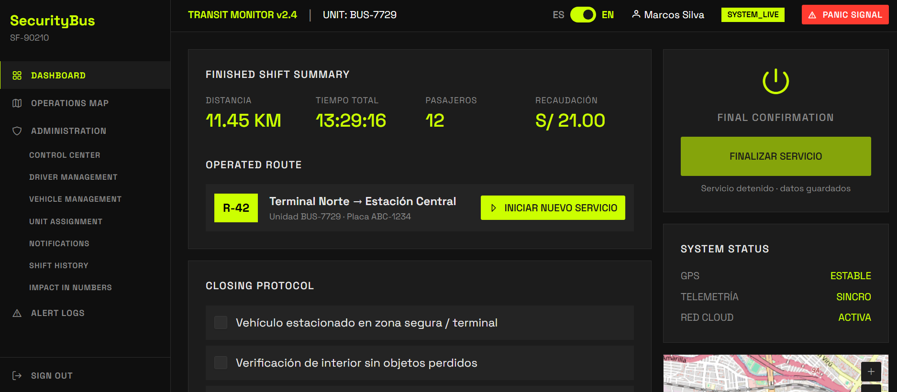

Mapa del servicio y centro de control. El mapa dibuja la posición de las unidades y las alertas activas sobre los tiles de OpenStreetMap. El conductor ve su unidad y la empresa ve toda la flota.

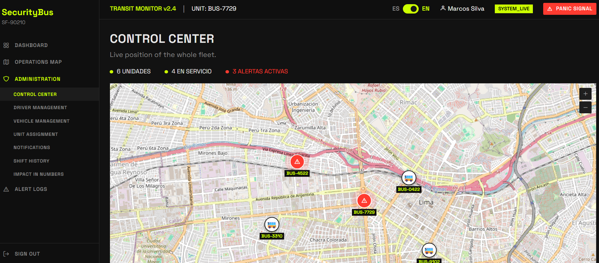

Botón de pánico. Disponible en el toolbar, envía la alerta con la ubicación de la unidad y abre una ventana de 5 segundos para cancelarla.


Registro y detalle de alertas. El registro lista las alertas por fecha y estado y permite reenviar las pendientes. El detalle muestra la línea de tiempo de la alerta, el número de intentos y su confirmación.

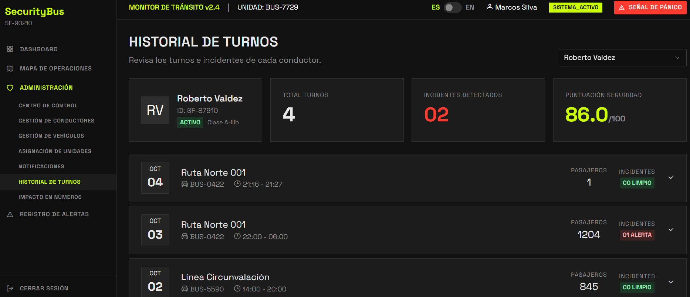

Notificaciones. Presenta los destinatarios activos con su rol y canal, y el registro de entregas con su prioridad y estado.

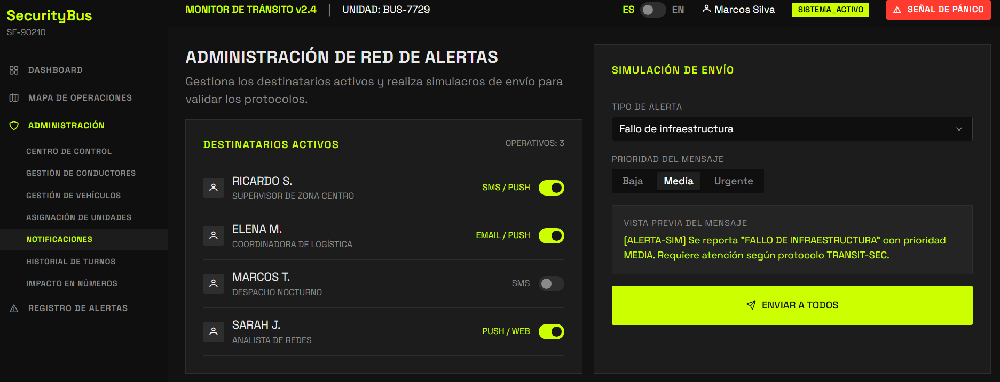

Gestión de conductores, vehículos y asignaciones. Tablas con formularios para crear, editar y eliminar registros, y una vista para asociar conductores con unidades y rutas.

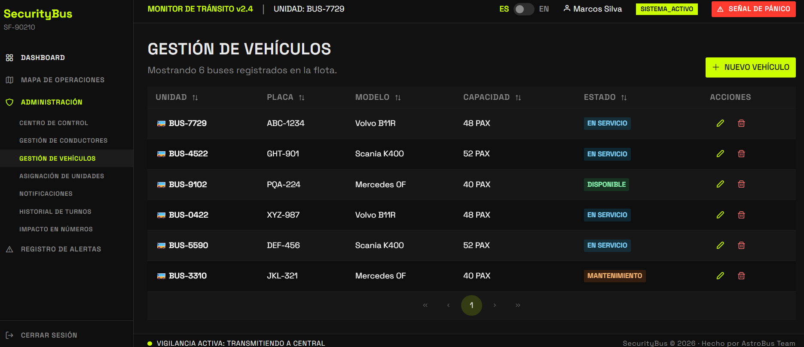

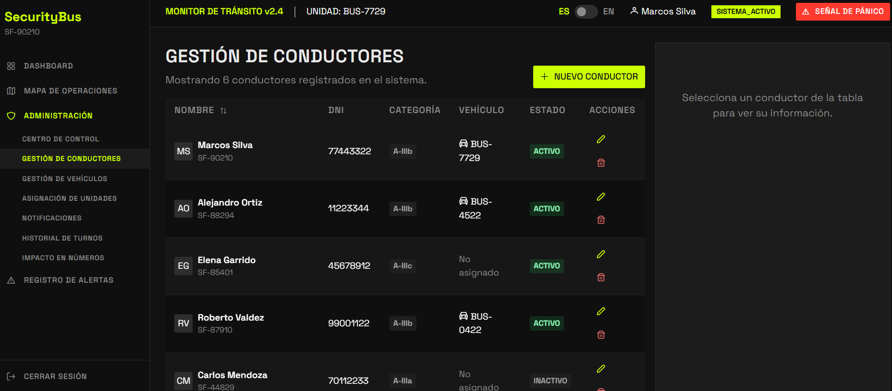

Historial de turnos e impacto en números. El historial lista los turnos con su ruta, distancia, pasajeros e incidentes. La vista de impacto resume indicadores y gráficos de pasajeros y alertas.

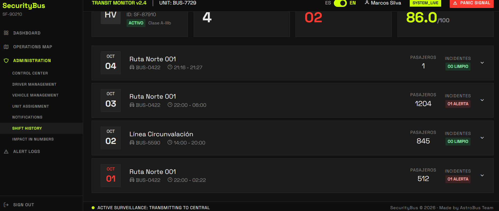

Para evidenciar las funcionalidades implementadas, se adjunta un video donde se muestra la navegación entre las vistas, la interacción con el botón de pánico y la comunicación con la Fake API desplegada.

URL del video de ejecución de la Web Application: [https://upcedupe-my.sharepoint.com/:v:/g/personal/u202418823_upc_edu_pe/IQC9xqrLUfGBTKetm5mY0sOrAQ1vPREJ-m9pPR_8LgcypCI?e=u1aGF4&nav=eyJyZWZlcnJhbEluZm8iOnsicmVmZXJyYWxBcHAiOiJTdHJlYW1XZWJBcHAiLCJyZWZlcnJhbFZpZXciOiJTaGFyZURpYWxvZy1MaW5rIiwicmVmZXJyYWxBcHBQbGF0Zm9ybSI6IldlYiIsInJlZmVycmFsTW9kZSI6InZpZXcifX0%3D](https://upcedupe-my.sharepoint.com/:v:/g/personal/u202418823_upc_edu_pe/IQC9xqrLUfGBTKetm5mY0sOrAQ1vPREJ-m9pPR_8LgcypCI?e=u1aGF4&nav=eyJyZWZlcnJhbEluZm8iOnsicmVmZXJyYWxBcHAiOiJTdHJlYW1XZWJBcHAiLCJyZWZlcnJhbFZpZXciOiJTaGFyZURpYWxvZy1MaW5rIiwicmVmZXJyYWxBcHBQbGF0Zm9ybSI6IldlYiIsInJlZmVycmFsTW9kZSI6InZpZXcifX0%3D)

##### 5.2.2.6. Services Documentation Evidence for Sprint Review

Durante el Sprint 2, el equipo implementó y desplegó una Fake API RESTful con json-server, que simula el comportamiento del backend de SecurityBus mientras se desarrollan los servicios reales. La API expone siete recursos (conductores, vehículos, asignaciones, turnos, alertas, destinatarios y entregas) y soporta operaciones CRUD con los verbos GET, POST, PUT y DELETE. Su configuración de rutas redirige el prefijo /api/v1 a los recursos de la base de datos, de forma que la aplicación consume la misma estructura de URL que tendrá el servicio definitivo. Esto permitió desacoplar la aplicación web de datos locales y realizar pruebas colaborativas sobre una API pública.

URL base del servicio: [https://astro-bus-team-fake-api-aw-730.vercel.app](https://astro-bus-team-fake-api-aw-730.vercel.app)


Dado que json-server no genera documentación OpenAPI automáticamente, en este Sprint los endpoints se documentan en las siguientes tablas. La especificación OpenAPI formal se elaborará con los Web Services definitivos en los siguientes Sprints.

|Endpoint|Acciones implementadas|Descripción|
|--------|----------------------|-----------|
|/drivers|GET,POST,PUT,DELETE|Gestión de conductores|
|/vehicles|GET,POST,PUT,DELETE|Gestión de vehículos de la flota|
|/assignments|GET,POST,DELETE|Asociación entre conductor, vehículo y ruta|
|/shifts|GET,POST,PUT|Registro de turnos de servicio|
|/alerts|GET,POST,PUT,DELETE|Emisión, consulta, actualización y reenvío de alertas|
|/recipients|GET,PUT|Destinatarios de las alertas|
|/deliveries|GET,POST|Registro de entregas de notificaciones|

|Acción|Verbo HTTP|Sintaxis de llamada|Parámetros|Response|
|------|---------|-------------------|------------|-------|
|Listar recursos|GET|/{recurso}|Opcionales: filtros por campo, por ejemplo ?employeeCode=SF-90210 o ?driverId=1&status=active|200 OK con un arreglo JSON.|
|Obtener por id|GET|/{recurso}/{id}|id en la ruta|200 OK con el recurso. 404 si no existe.|
|Crear|POST|/{recurso}|Cuerpo JSON con los campos del recurso|201 Created con el recurso y su id.|
|Actualizar|PUT|/{recurso}/{id}|id en la ruta y cuerpo JSON completo|200 OK con el recurso actualizado.|
|Eliminar|DELETE|/{recurso}/{id}|id en la ruta|	200 OK con un objeto vacío.|

Ejemplo 1. Verificación del conductor por código de empleado (US01 y US14).

```
GET /api/v1/drivers?employeeCode=SF-90210
```

El response es un arreglo con el conductor que coincide, junto con los datos de su licencia y su estado:

```
[
  {
    "id": 1,
    "employeeCode": "SF-90210",
    "firstName": "Marcos",
    "lastName": "Silva",
    "dni": "77443322",
    "category": "A-IIIb",
    "licenseNumber": "Q77443322",
    "licenseExpiry": "2027-05-12",
    "points": 14,
    "rating": 4.9,
    "yearsExperience": 12,
    "status": "active"
  }
]
```

Ejemplo 2. Consulta de la asignación vigente del conductor (US14 y US15).

```
GET /api/v1/assignments?driverId=1&status=active
```

```
[
  {
    "id": 1,
    "driverId": 1,
    "vehicleId": 1,
    "route": "R-42 Terminal Norte - Estación Central",
    "startTime": "05:30",
    "status": "active"
  }
]
```

Ejemplo 3. Emisión de una alerta de pánico con la ubicación de la unidad (US03, US05 y US42).

```
POST /api/v1/alerts
Content-Type: application/json
```

```
{
  "code": "AL-9928",
  "vehicleId": 4,
  "type": "Botón de pánico",
  "receiver": "UNIDAD_MOVIL_04",
  "attempts": 1,
  "status": "pending",
  "createdAt": "2026-10-04T14:22:05",
  "latitude": -12.042,
  "longitude": -77.034
}
```

El response es 201 Created con el mismo objeto y el id generado. Mientras la alerta no sea confirmada, puede reenviarse con PUT /alerts/{id}, que incrementa attempts hasta un máximo de 3.

La Fake API implementa los siguientes servicios técnicos (Technical Stories) de la épica EPNN05:

| TS | Servicio | Verbo y Endpoint | Respuesta de éxito | Respuesta de fracaso |
|----|----------|------------------|--------------------|----------------------|
| TS01 | Validación de conductores | GET /drivers?employeeCode={código} | 200 con 1 conductor y su estado | 200 con arreglo vacío si el código no existe |
| TS02 | Apertura de servicio | POST /shifts | 201 con el turno y su id | No valida datos(limitación de json-server) |
| TS03 | Emisión de alertas | POST /alerts | 201 con la alerta y su id | No valida datos (limitación de json-server) |
| TS04 | Actualización del conteo | PUT /shifts/{id} | 200 con pasajeros y velocidad actualizados | 404 si el turno no existe |
| TS06 | Estado de la unidad | GET /vehicles/{id} | 200 con status, latitude y longitude | 404 si la unidad no existe | 
| TS08 | Cierre de servicio | PUT /shifts/{id} | 200 con status: finished y endTime | 404 si el turno no existe |

Los turnos (shifts) incorporan, además, los campos del monitoreo de velocidad:

| Campo | Tipo | Descripción | Ejemplo |
|-------|------|-------------|---------|
| speedKmh | número | Velocidad actual del bus en km/h (0 al cerrar el turno) | 58 | 
| maxSpeedKmh | número | Velocidad máxima registrada en el turno | 64 | 
| averageSpeedKmh | número | Velocidad promedio del turno | 41.2 | 
| speedSamples | entero | Cantidad de mediciones de velocidad tomadas | 6 | 
 overspeedEvents | entero | Veces que se cruzó el limite de 60 km/h | 1 | 

**Monitoreo de velocidad**

Durante el servicio, la aplicación simula la velocidad del bus cada 5 segundos y la guarda en la Fake API mediante PUT /shifts/{id} (TS04). El límite es de 60 km/h; desde 48 km/h se muestra una precaución y cada vez que se cruza el límite se registra un exceso. Cada turno guarda la velocidad actual, promedio y máxima, y la cantidad de excesos. Con esos datos y los incidentes se calcula un puntaje de conducta del conductor (buena, regular o de riesgo), que se muestra en el dashboard, el mapa del servicio, el historial de turnos, los números de impacto y la gestión de conductores.

| Regla | Valor |
|-------|-------|
| Límite de velocidad | 60 km/h |
| Precaución | Más de 48 km/h y hasta 60 km/h | 
| Exceso | Más de 60 km/h; se cuenta uno solo al cruzar el límite, no en cada medición |
| Simulación | Cada 5 segundos, entre 15 y 88 km/h |
| Puntaje de conducta | Base = calificación x 20 (80 si no hay calificación), menos 3 por exceso y 5 por incidente; entre 0 y 100 |
| Nivel de conducta | Buena (85 o más), regular (60 a 84), de riesgo (menos de 60)

Ejemplo 4. Apertura de un servicio de conducción (TS02, US02)

```
POST /api/v1/shifts
Content-Type: application/json
```

```
{
 "driverId": 1,
 "vehicleId": 1,
 "routeCode": "R-42",
 "routeName": "Terminal Norte - Estación Central",
 "date": "2026-10-04",
 "startTime": "2026-10-04T08:00:00",
 "endTime": null,
 "distanceKm": 0,
 "passengers": 0,
 "revenue": 0,
 "incidents": 0,
 "status": "active",
 "speedKmh": 0,
 "maxSpeedKmh": 0,
 "averageSpeedKmh": 0,
 "speedSamples": 0,
 "overspeedEvents": 0
}
```

El response es 201 Created con el mismo objeto y el id generado

Ejemplo 5. Actualización de pasajeros y velocidad durante el servicio (TS04). json-server reemplaza el objeto completo, por eso se envía entero.

```
PUT /api/v1/shifts/8
Content-Type: application/json
```

```
{
 "id": 8,
 "driverId": 1,
 "vehicleId": 1,
 "routeCode": "R-42",
 "routeName": "Terminal Norte - Estación Central",
 "date": "2026-10-04",
 "startTime": "2026-10-04T08:00:00",
 "endTime": null,
 "distanceKm": 0.52,
 "passengers": 3,
 "revenue": 5,
 "incidents": 0,
 "status": "active",
 "speedKmh": 64,
 "maxSpeedKmh": 64,
 "averageSpeedKmh": 41.2,
 "speedSamples": 6,
 "overspeedEvents": 1
}
```

El response es 200 OK con el turno actualizado. Para cerrar el servicio (TS08) se envía el mismo PUT con endTime completado, status en finished y speedKmh en 0.


**Pruebas de endpoints**
Para validar la Fake API se ejecutaron 29 pruebas sobre los siete recursos (drivers, vehicles, assignments, shifts, alerts, recipients y deliveries) y los cuatro verbos HTTP (GET, POST, PUT y DELETE). La URL base es https://astro-bus-team-fake-api-aw-730.vercel.app/api/v1 . La columna HTTP indica el código de estado devuelto por la API en cada prueba.

| Id | Recurso | Verbo y URL | Qué se prueba | Resultado esperado | HTTP | TS / US |
|----|---------|-------------|---------------|--------------------|------|---------|
| P01 | drivers | GET /drivers | Listar conductores | 200 con arreglo | 200 | |
| P02 | drivers | GET /drivers?employeeCode=SF-90210  | Código registrado  | 200 con conductor, status: active | 200 | TS01, US14 |
| P03 | drivers | GET /drivers?employeeCode=NO-EXISTE  | Código inexistente | 200 con arreglo vacío | 200 | TS01 |
| P04 | drivers | GET /drivers/1 | Obtener por id | 200 con el conductor | 200 | US01 |
| P05 | drivers | GET /drivers/999 | Id inexistente | 404 | 404 | TS01 |
| P06 | drivers | POST /drivers  | Crear conductor | 201 con el recurso e id  | 201 | US15 |
| P07 | drivers | PUT /drivers/{id}  | Actualizar conductor  | 200 con el recurso
actualizado | 200 | TS10 |
| P08 | drivers | DELETE /drivers/{id}  | Eliminar el creado en P06 | 200 con objeto vacío | 200 | |
| P09 | vehicles | GET /vehicles   | Listar vehículos | 200 con arreglo  | 200 | US43 |
| P10 | vehicles | GET /vehicles/1   | Estado y posición de la unidad | 200 con status, latitude, longitude  | 200 | TS06 |
| P11 | vehicles | POST /vehicles  | Crear vehículo | 201 | 201 | |
| P12 | vehicles | PUT /vehicles/{id} | Actualizar posición o estado | 200 | 200 | |
| P13 | vehicles | DELETE /vehicles/{id} | Eliminar el creado en P11 | 200 | 200 | |
| P14 | assignments | GET /assignments?driverId=1&status=active | Asignación vigente  | 200 con 1 asignación | 200 | US14, US15 |
| P15 | assignments | POST /assignments  | Vincular conductor y vehículo | 201 | 201 | US15 |
| P16 | assignments | DELETE /assignments/{id}   | Desvincular | 200 | 200 | |
| P17 | shifts | GET /shifts?driverId=1 | Turnos del conductor, con campos de velocidad | 200 con arreglo | 200 | US26 |
| P18 | shifts | POST /shifts   | Abrir servicio (Ejemplo 4) | 201 con id  campos de velocidad en 0 | 201 | TS02, US02 |
| P19 | shifts | PUT /shifts/{id}   | Actualizar pasajeros y velocidad (Ejemplo 5) | 200 con speedKmh y overspeedEvents actualizados | 200 | TS04 |
| P20 | shifts | PUT /shifts/{id}  | Cerrar servicio (finished, speedKmh en 0) | 200 | 200 | TS08, US25 |
| P21 | alerts | GET /alerts   | Historial de alertas | 200 con arreglo | 200 | US16 |
| P22 | alerts | GET /alerts?status=pending  | Filtrar pendientes | 200 con arreglo | 200 | US24 |
| P23 | alerts | POST /alerts    | Emitir alerta con latitud y longitud  | 201 con id | 201 | TS03, US03, US05, US42|
| P24 | alerts | PUT /alerts/{id}  | Reenviar (attempts +1)  | 200 | 200 | US23, US24|
| P25 | alerts | DELETE /alerts/{id}   | Eliminar alerta de prueba  | 200 | 200 | |
| P26 | recipients | GET /recipients    | Destinatarios  | 200 con arreglo | 200 | US33|
| P27 | recipients | PUT /recipients/{id}   | Activar o desactivar | 200 | 200 | US33 |
| P28 | deliveries | GET /deliveries   | Entregas de notificaciones | 200 con arreglo | 200 | US33 |
| P29 | deliveries | POST /deliveries    | Registrar entrega  | 201 | 201 | US33 |

Limitación de la Fake API: json-server acepta cualquier cuerpo JSON, por lo que los escenarios de fracaso por datos faltantes o inconsistentes de las TS no
devuelven error en esta etapa. Solo se comprueban los fracasos por recurso inexistente (404) y por filtro sin coincidencias (arreglo vacío). La validación de
datos se implementará en el backend definitivo.


Se adjuntan las siguientes capturas de la interacción con la API usando los datos de muestra:

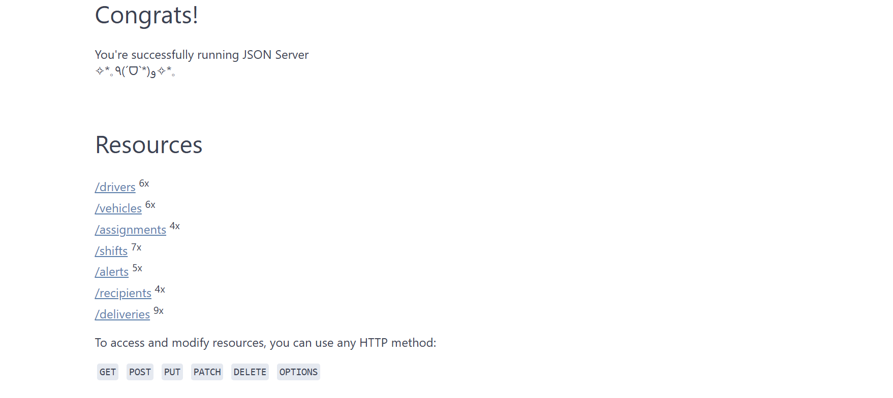

<br>

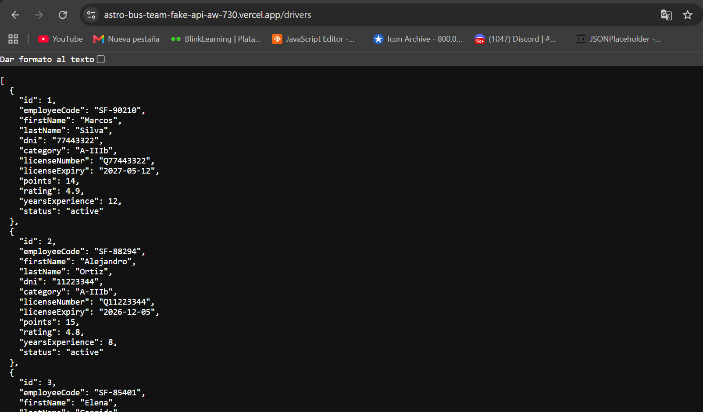


Repositorio de la Fake API: [https://github.com/AstroBusTeam/AstroBusTeam-fake-api-aw-730](https://github.com/AstroBusTeam/AstroBusTeam-fake-api-aw-730)

Commits relacionados con la API en este Sprint:

|Commit Id|Commit Message|Descripción Técnica|
|---------|---------------|------------------|
|f6589ff  |feat: deploy fake-api| Se implementó la configuración inicial necesaria para desplegar la Fake API, preparando el proyecto para ejecutarse en un entorno de producción mediante Vercel.|
|aaaac67  |fix: import express in entrypoint for Vercel detection|Se corrigió el punto de entrada de la aplicación incorporando la importación de Express, permitiendo que Vercel identifique correctamente el servidor y pueda ejecutar la Fake API.|
|894f6b3|fix: import express in entrypoint so Vercel detects the Express app|Se agregó la importación de Express en el archivo de entrada de la aplicación para que Vercel pueda detectar correctamente la aplicación Express durante el despliegue.|


##### 5.2.2.7. Software Deployment Evidence for Sprint Review

Durante el Sprint 2, el equipo realizó el despliegue de la Web Application y de la Fake API. A diferencia del Sprint 1, donde solo se publicó la Landing Page en GitHub Pages, en esta iteración se consolidó una arquitectura de dos servicios: la aplicación web, publicada con Firebase Hosting, y la Fake API, publicada en Vercel. Ambos servicios se configuran mediante variables de entorno, de modo que la URL base de la API y las rutas de cada recurso no quedan escritas en el código.

La arquitectura de despliegue se compone de los siguientes elementos:

Web Application: aplicación Vue 3 compilada con Vite, cuyo resultado (carpeta dist) se publica en Firebase Hosting.
Fake API: servicio RESTful basado en json-server, publicado en Vercel.
Variables de entorno: archivos .env.development y .env.production con la URL base de la API, las rutas de los recursos y el servidor de tiles del mapa.

**Despliegue de la Fake API en Vercel**

- Se creó la cuenta en Vercel y se importó el repositorio de la Fake API desde GitHub.
- Se configuró json-server con el archivo db.json y se definió en routes.json la redirección del prefijo /api/v1/* hacia los  recursos.
- Se publicó el proyecto y Vercel generó la URL pública del servicio.
- Se verificó el funcionamiento consultando los recursos desde el navegador y desde la Web Application.

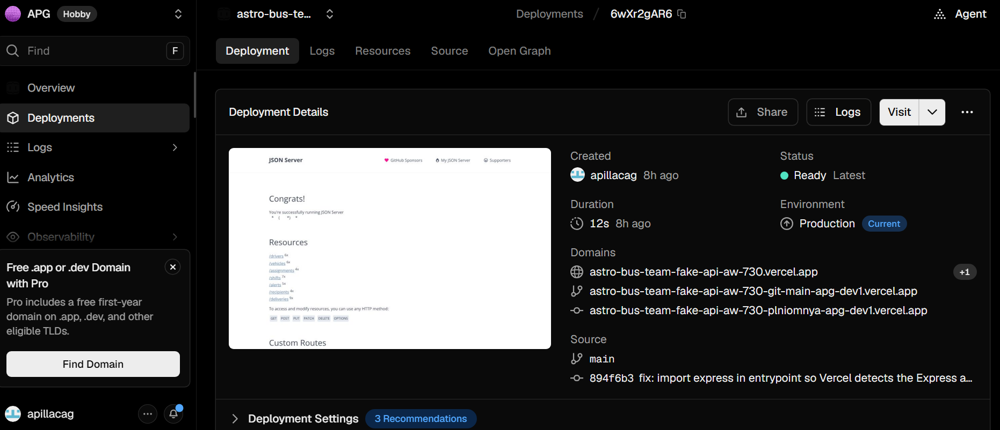

**Despliegue de la Web Application en Firebase Hosting**

- Se creó el proyecto en Firebase y se habilitó Hosting.
- Se configuró firebase.json con la carpeta dist como directorio público y una regla de reescritura de todas las rutas hacia index.html, necesaria para que Vue Router funcione al recargar la página.
- Se definió en .env.production la URL base de la Fake API desplegada.
- Se generó la versión de producción con npm run build y se publicó con Firebase Hosting.
<br>

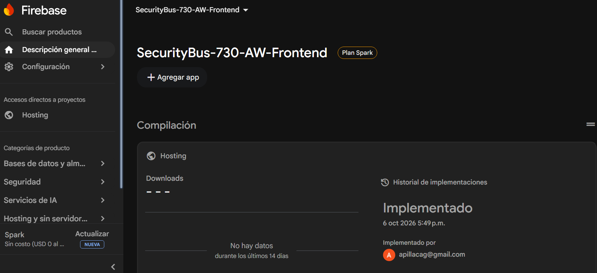

La Web Application desplegada está disponible en: [https://securitybus-730-aw-front-7bf31.web.app/](https://securitybus-730-aw-front-7bf31.web.app/)

Repositorio de la Web Application: [https://github.com/AstroBusTeam/AstroBusTeam-FrontEnd](https://github.com/AstroBusTeam/AstroBusTeam-FrontEnd)


##### 5.2.2.8. Team Collaboration Insights during Sprint

Durante el Sprint 2, el equipo trabajó de forma colaborativa en la implementación de la Web Application y de la Fake API. Se mantuvo la estrategia GitFlow definida en la configuración del proyecto: cada funcionalidad se desarrolló en una rama feature/* creada a partir de develop, y los cambios se integraron mediante Pull Requests revisados por otro integrante antes de incorporarse. Los commits siguieron la convención Conventional Commits, lo que permitió mantener la trazabilidad de cada cambio.

El trabajo se distribuyó según la matriz de líderes y colaboradores de la sección 5.2.2.2. Cada integrante lideró un aspecto del Sprint y colaboró en los demás: IAM & Operations, Fleet Management, Alerts Management, Fake API y Deployment. Esta organización permitió que la interfaz, los datos de prueba y el despliegue avanzaran en paralelo. El seguimiento de las tareas se realizó en el tablero de Trello del Sprint.

A continuación se presentan las evidencias extraídas de los repositorios del proyecto, que reflejan la participación de los integrantes durante el Sprint.

**Evidencia 1: Gráfico de contribuciones por integrante**

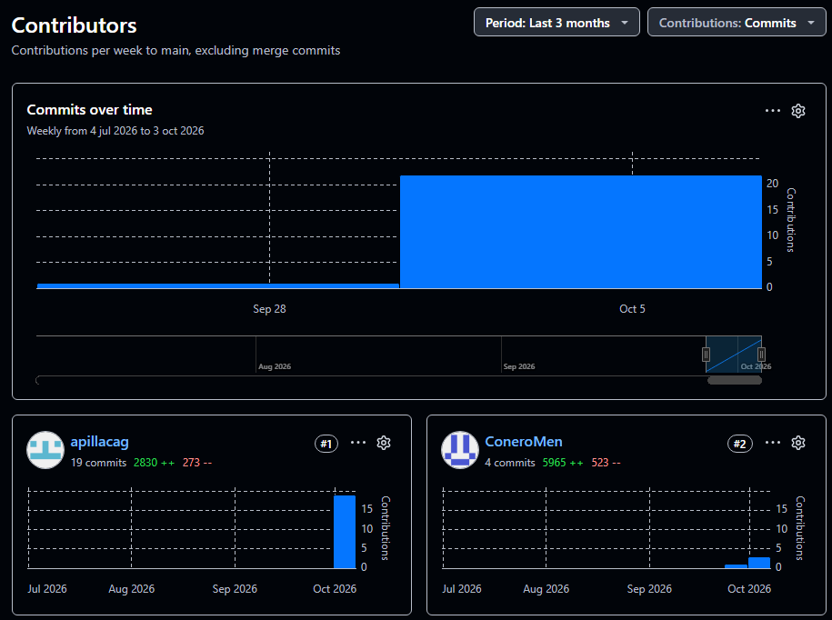

**Evidencia 2: Resumen de actividad del Sprint mediante GitHub Pulse**

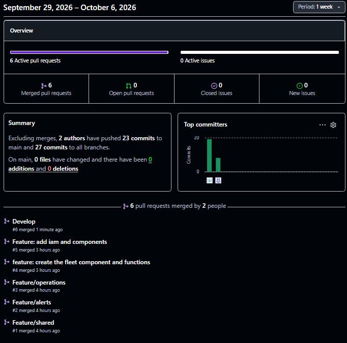

<br>

**Evidencia 3: Gestión de cambios mediante Pull Requests**

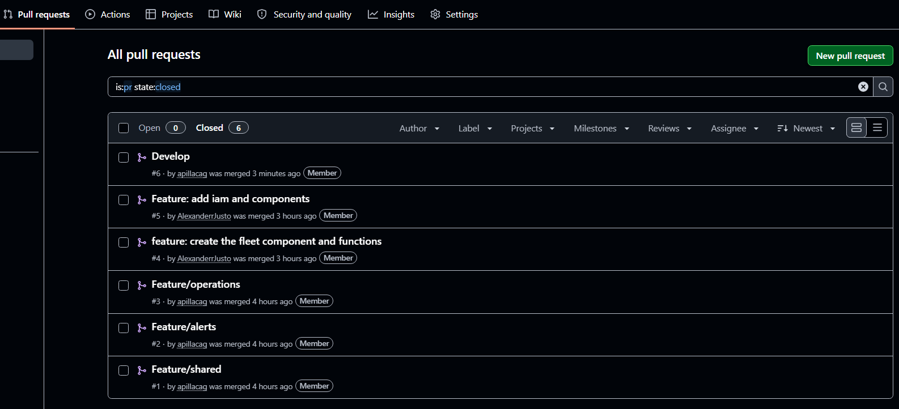

<br>

**Evidencia 4: Organización de ramas bajo GitFlow**

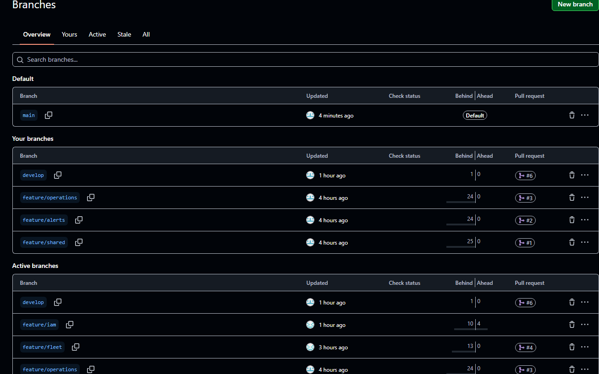

<br>

Las evidencias muestran que todos los integrantes participaron en la implementación, con commits distribuidos durante el Sprint e integraciones frecuentes hacia la rama develop. Entre las actividades colaborativas más relevantes destacan:

- Implementación de las vistas del conductor: verificación de identidad, dashboard, mapa y botón de pánico.
- Desarrollo de los módulos de flota y alertas, con sus tablas, formularios y detalle.
- Configuración de la Fake API y conexión de la aplicación mediante variables de entorno.
- Internacionalización de la interfaz en español e inglés.
- Despliegue de la Web Application y de la Fake API.

Repositorio de la Web Application: [https://github.com/AstroBusTeam/AstroBusTeam-FrontEnd](https://github.com/AstroBusTeam/AstroBusTeam-FrontEnd)

Repositorio de la Fake API: [https://github.com/AstroBusTeam/AstroBusTeam-fake-api-aw-730](https://github.com/AstroBusTeam/AstroBusTeam-fake-api-aw-730)

#### 5.2.3. Sprint 3

##### 5.2.3.1. Sprint Planning 3

La planificación del Sprint 3 es el punto de partida de la iteración: en ella el equipo revisó los resultados del Sprint anterior, recogió los aprendizajes de su retrospectiva y fijó el objetivo, las historias técnicas seleccionadas y la capacidad de trabajo comprometida. La siguiente tabla resume el acta de dicha reunión.

| Sprint # | Sprint 3 |
| :--- | :--- |
| **Sprint Planning Background** | |
| Date | 26/10/2026 |
| Time | 4:00 PM |
| Location | Virtual |
| Prepared By | Justo Yauricasa, Alexander Paolo |
| Attendees (to planning meeting) | Alvarado Millan, Boris <br> Justo Yauricasa, Alexander Paolo <br> Martinez Ramos, Bryan Felix <br> Pillaca Gonzales, Andy Saúl <br> Nawrocki Loureiro, Ian Andre |
| **Sprint 2 Review Summary** | Durante el Sprint 2 se implementó la aplicación web de SecurityBus con Vue 3, organizada en los bounded contexts IAM, Fleet, Operations, Alerts y Shared, y se publicó en Firebase Hosting. Los datos provenían de una Fake API construida con json-server y desplegada en Vercel, que exponía siete recursos bajo el prefijo /api/v1 y simulaba los servicios técnicos TS01, TS02, TS03, TS04, TS06 y TS08. |
| **Sprint 2 Retrospective Summary** | El equipo destacó que el uso de componentes reutilizables y de ramas por bounded context aceleró el desarrollo. Como oportunidad de mejora, se acordó definir primero los contratos de datos (recursos, rutas y códigos de respuesta) y conservar en el backend la estructura de URL /api/v1 de la Fake API, con el fin de integrar ambos componentes sin reprocesos. |
| **Sprint Goal & User Stories** | |
| **Sprint 3 Goal** | Desarrollar los Web Services RESTful de SecurityBus con C# y ASP.NET Core, persistir la información en una base de datos relacional MySQL mediante Entity Framework Core, documentar los endpoints con OpenAPI, desplegar el backend en Microsoft Azure y conectar la aplicación web para reemplazar por completo la Fake API. El objetivo se considerará cumplido cuando la aplicación opere sobre el backend desplegado y las entrevistas de validación evidencien el funcionamiento del flujo completo. |
| **Sprint 3 Velocity** | 22 Story Points |
| **Sum of Story Points** | 22 Story Points (TS01: 3, TS02: 3, TS03: 3, TS04: 2, TS05: 3, TS06: 3, TS08: 2, TS10: 3) |

##### 5.2.3.2. Aspect Leaders and Collaborators

La matriz de liderazgo y colaboración permite repartir las responsabilidades del Sprint de forma explícita. Para cada aspecto del producto se designa a un integrante líder (L), responsable de coordinar su avance y de responder por su calidad, y se reconoce al resto como colaboradores (C), quienes aportan en su desarrollo y revisión. Esta organización evita la dispersión del trabajo, facilita la revisión del código mediante Pull Requests y permite saber con certeza a quién consultar ante una decisión técnica.
 
Dado que el Sprint 3 abarca la construcción completa del backend, el equipo dividió el trabajo siguiendo los bounded contexts definidos en la arquitectura de Domain-Driven Design, de modo que cada integrante pudiera desarrollar un contexto con autonomía. A ello se sumaron dos aspectos transversales: la integración y el despliegue, y la validación con usuarios. Los aspectos definidos para el Sprint fueron los siguientes:

1. Shared (persistencia): modelo de datos, llaves foráneas, repositorio base, Unit of Work, auditoría, datos de ejemplo y OpenAPI localizado.
2. Fleet Management: conductores, vehículos, rutas y asignaciones.
3. Operations: turnos de servicio y posiciones de los vehículos.
4. Alerts Management: alertas, tipos de alerta, intentos, entregas, destinatarios, canales y centros de control.
5. IAM: verificación de la identidad del conductor y usuarios del sistema.
6. Frontend Integration & Deployment: adaptación del frontend al backend, internacionalización de la API, política CORS y despliegue en Azure.
7. Validation Interviews: diseño, ejecución y análisis de las entrevistas de validación y de las evaluaciones heurísticas.

|Team Member (Last Name, First Name) | GitHub Username | Shared | Fleet | Operations | IAM | Frontend Integration & Deployment | Validation Interviews |
|---------------------|----------|--------|--------|---------|----------|-------------|--------------|
| Alvarado Millan, Boris | borisalvaradomillanPE | L | C | C | C | C | C |
| Justo Yauricasa, Alexander Paolo | AlexanderrJusto | C | L | C | C | C | C |
| Martinez Ramos, Bryan Felix | BryanMR1 | C | L | C | C | C | C |
| Nawrocki Loureiro, Ian Andre | IanNaw | C | C | C | L | C | C |
| Pillaca Gonzales, Andy Saúl | apillacag | C | C | C | C | L | L |

Como se observa en la matriz, cada bounded context tuvo un líder distinto, lo que permitió desarrollar en paralelo la persistencia, la gestión de flota, las operaciones, las alertas y la verificación de identidad. La integración con el frontend y el despliegue fueron lideradas por quien había construido la aplicación web, con el fin de resolver de forma directa los ajustes necesarios entre ambos componentes. La siguiente tabla precisa el alcance de cada aspecto y sus entregables principales.
 
| Aspecto | Líder | Alcance | Entregables principales |
|---|---|---|---|
| Shared | Boris Alvarado | Infraestructura común de persistencia y documentación | `AppDbContext` con convención snake_case y llaves foráneas, repositorio base, Unit of Work, interceptor de auditoría, patrón Result, `DatabaseSeeder`, convención de rutas kebab-case y OpenAPI localizado |
| Fleet | Bryan Martinez | Gestión de la flota | Agregados Driver, Vehicle y Assignment; comandos y consultas; repositorios; controladores REST; fachada ACL para otros contextos |
| Operations | Alexander Justo | Operación diaria del servicio | Dominio, aplicación, infraestructura e interfaces de turnos y posiciones de los vehículos |
| Alerts | Andy Pillaca | Emergencias y notificaciones | Alertas, tipos, intentos, entregas, destinatarios, canales y centros de control, con sus controladores, recursos y assemblers |
| IAM | Ian Nawrocki | Identidad del conductor | Comando y servicio de verificación, objeto de valor `EmployeeCode`, `AuthenticationController` y usuarios |
| Frontend Integration & Deployment | Andy Pillaca | Conexión y publicación | `backend-adapter.js`, internacionalización, CORS, variables de entorno y despliegue en Azure y Firebase |

##### 5.2.3.3. Sprint Backlog 3

El Sprint Backlog es el plan de trabajo de la iteración: recoge las historias seleccionadas del Product Backlog y las descompone en tareas concretas que pueden estimarse, asignarse y verificarse. Su utilidad radica en que establece una relación trazable entre lo planificado y lo entregado, y en que permite al equipo monitorear el avance durante el Sprint.
 
En esta iteración, las historias seleccionadas corresponden a Technical Stories (TS) que trasladan al backend real los servicios que en el Sprint 2 solo estaban simulados por la Fake API, junto con los servicios adicionales de consulta de historial y de actualización de conductores. Dado que dichos servicios no pueden funcionar sin una base de datos, una documentación y un entorno de ejecución, el equipo registró además tareas de soporte técnico: persistencia, documentación de la API, integración del frontend, documentación del código y despliegue. Estas tareas no se derivan de una historia del Product Backlog, por lo que figuran sin identificador de historia. La tabla detalla, para cada tarea, su descripción, estimación, responsable y estado.

Tablero del Sprint 3: [https://trello.com/invite/b/6af3aa6210bbb1771aa16425/ATTIe323ac84aa52ddf51ec4610c3435f428EAB6D261/sprint-3-astrobusteam](https://trello.com/invite/b/6af3aa6210bbb1771aa16425/ATTIe323ac84aa52ddf51ec4610c3435f428EAB6D261/sprint-3-astrobusteam)

| User Story Id | User Story Title | Work Item / Task Id | Work Item / Task Title | Description | Estimation | Assigned To | Status |
|---|---|---|---|---|---|---|---|
| TS01 | Servicio de validación de conductores | T28 | Verificación de conductor | `POST /authentication/driver-verification` y `GET /drivers?employeeCode=` validan la identidad y el estado del conductor. | 3h | Ian Nawrocki | Done |
| TS02 | Servicio de apertura de servicio | T29 | Apertura de turno | `POST /shifts` registra el turno y devuelve su identificador. | 3h | Alexander Justo | Done |
| TS03 | Servicio de emisión de alertas | T30 | Emisión de alerta | `POST /alerts` registra la alerta con su ubicación. | 3h | Andy Pillaca | Done |
| TS04 | Servicio de actualización del conteo | T31 | Actualización de turno | `PUT /shifts/{id}` actualiza pasajeros, velocidad y recaudación. | 2h | Alexander Justo | Done |
| TS05 | Servicio de consulta del historial | T32 | Filtros de historial | Filtros en alertas (`status`), intentos (`alertId`), asignaciones, turnos y posiciones. | 3h | Andy Pillaca | Done |
| TS06 | Servicio de consulta del estado de la unidad | T33 | Estado de la unidad | `GET /vehicles/{id}` y `GET /vehicle-positions?vehicleId=`. | 3h | Bryan Martinez | Done |
| TS08 | Servicio de cierre de servicio | T34 | Cierre de turno | `PUT /shifts/{id}` con `status` y `endTime`. | 2h | Alexander Justo | Done |
| TS10 | Servicio de actualización de conductores | T35 | Actualización de conductor | `PUT /drivers/{id}`. | 3h | Bryan Martinez | Done |
| — | Persistencia (soporte técnico) | T36 | Modelo de 15 tablas | `AppDbContext` con convención snake_case, llaves foráneas con `OnDelete(Restrict)` y vista `v_shift_summary`. | 4h | Boris Alvarado | Done |
| — | Persistencia (soporte técnico) | T37 | Datos de ejemplo | `DatabaseSeeder` y `SampleData`, equivalentes al `db.json` de la Fake API. | 3h | Boris Alvarado | Done |
| — | Documentación de la API | T38 | OpenAPI localizado | OpenAPI nativo de ASP.NET Core, Scalar y rutas en kebab-case, en español e inglés. | 3h | Andy Pillaca | Done |
| — | Integración del frontend | T39 | Adaptador del backend | `backend-adapter.js` traduce el modelo del backend al del frontend sin modificar stores ni vistas. | 5h | Andy Pillaca | Done |
| — | Despliegue | T40 | Despliegue en Azure | Web App Linux con .NET 10 y servidor MySQL flexible, con CORS para el frontend. | 4h | Andy Pillaca | Done |

##### 5.2.3.4. Development Evidence for Sprint Review

Esta sección presenta la evidencia del desarrollo del backend: qué se construyó, con qué arquitectura y mediante qué commits quedó registrado en el repositorio.
 
Durante el Sprint 3 el equipo implementó los Web Services de SecurityBus con C# y ASP.NET Core (.NET 10), organizados en cinco bounded contexts (Shared, Fleet, Operations, Alerts e IAM) que respetan las capas de Domain-Driven Design: Domain, Application, Infrastructure e Interfaces. La persistencia se resolvió con Entity Framework Core sobre MySQL, con un modelo de 15 tablas (`drivers`, `vehicles`, `routes`, `assignments`, `shifts`, `vehicle_positions`, `alerts`, `alert_types`, `alert_attempts`, `deliveries`, `recipients`, `recipient_channels`, `notification_channels`, `control_centers` y `users`) y la vista `v_shift_summary`, que consolida cada turno con su conductor, vehículo, ruta y cantidad de alertas.
 
Complementan la implementación el patrón Result, el Unit of Work, un interceptor que audita las fechas de creación, la localización en español e inglés de las validaciones y de la documentación, el manejo centralizado de errores mediante `ProblemDetails` (RFC 7807), una política CORS configurable por entorno y la carga opcional de datos de ejemplo. La siguiente tabla reúne los commits que representan los hitos principales del Sprint.
 
| Repository | Branch | Commit Id | Commit Message | Committed on (Date) |
|---|---|---|---|---|
| AstroBusTeam-BackEnd | develop | 1e9986b | feat: install packages | 05/11/2026 |
| AstroBusTeam-BackEnd | develop | 1a19ced | feat: configure default connection | 06/11/2026 |
| AstroBusTeam-BackEnd | develop | 0f7401e | feat: configure default connection | 06/11/2026 |
| AstroBusTeam-BackEnd | feature/alerts | 341e6c6 | feat: create alerts directory | 06/11/2026 |
| AstroBusTeam-BackEnd | feature/alerts | 43405e9 | feat: create AlertResources.cs | 06/11/2026 |
| AstroBusTeam-BackEnd | feature/alerts | 4307b64 | feat: create CreateAlertResources.cs | 06/11/2026 |
| AstroBusTeam-BackEnd | feature/alerts | fff86f9 | feat: create DeliveryResources.cs | 06/11/2026 |
| AstroBusTeam-BackEnd | feature/alerts | 762b8e8 | feat: create RecipientResource.cs | 06/11/2026 |
| AstroBusTeam-BackEnd | feature/alerts | 410fccc | feat: create UpdateAlertResource.cs | 06/11/2026 |
| AstroBusTeam-BackEnd | feature/alerts | 917ed2e | feat: create UpdateRecipientResource.cs | 06/11/2026 |
| AstroBusTeam-BackEnd | feature/alerts | bc7f696 | feat: create AlertsController.cs | 06/11/2026 |
| AstroBusTeam-BackEnd | feature/alerts | 12a3169 | feat: create DeliveriesController.cs | 06/11/2026 |
| AstroBusTeam-BackEnd | feature/alerts | f685896 | feat: create RecipientsController.cs | 06/11/2026 |
| AstroBusTeam-BackEnd | feature/alerts | 75196a0 | feat: create ActionResultFromCreateAlertResultAssembler.cs | 06/11/2026 |
| AstroBusTeam-BackEnd | feature/alerts | 79a2c62 | feat: create ActionResultFromCreateDeliveryResultAssembler.cs | 06/11/2026 |
| AstroBusTeam-BackEnd | feature/alerts | e3c118f | feat: create ActionResultFromCreateDeleteAlertResultAssembler.cs | 06/11/2026 |
| AstroBusTeam-BackEnd | feature/alerts | eeb5d52 | feat: create ActionResultFromCreateUpdateAlertResultAssembler.cs | 06/11/2026 |
| AstroBusTeam-BackEnd | feature/alerts | 58c52d6 | feat: create ActionResultFromCreateUpdateRecipientResultAssembler.cs | 06/11/2026 |
| AstroBusTeam-BackEnd | feature/alerts | ffb39ca | feat: create AlertResourceFromEntityAssembler.cs | 06/11/2026 |
| AstroBusTeam-BackEnd | feature/alerts | 7bef758 | feat: create CreateAlertCommandFromResourceAssembler | 06/11/2026 |
| AstroBusTeam-BackEnd | feature/alerts | 090c185 | feat: create CreateDeliveryCommmandFromResourceAssembler | 06/11/2026 |
| AstroBusTeam-BackEnd | feature/alerts | ac8d146 | feat: create DeliveryResourceFromEntityAssembler.cs | 06/11/2026 |
| AstroBusTeam-BackEnd | feature/alerts | cb54f8b | feat: create RecipientResourceFromEntityAssembler.cs | 06/11/2026 |
| AstroBusTeam-BackEnd | feature/alerts | 820e7f7 | feat: create UpdateAlertCommandFromResourceAssembler | 06/11/2026 |
| AstroBusTeam-BackEnd | feature/alerts | 6f3c0e3 | feat: create UpdateRecipientCommandFromResourceAssembler | 06/11/2026 |
| AstroBusTeam-BackEnd | feature/alerts | 09e05b8 | feat: create domain repository | 06/11/2026 |
| AstroBusTeam-BackEnd | feature/alerts | 5611936 | feat: add Domain/repositories | 06/11/2026 |
| AstroBusTeam-BackEnd | feature/alerts | 1be485d | feat: add Domain/model | 06/11/2026 |
| AstroBusTeam-BackEnd | feature/alerts | bc228a2 | feat: create infrastructure/persistence/efc/repositories repository | 06/11/2026 |
| AstroBusTeam-BackEnd | feature/alerts | edd3842 | feat: create infastrucure/persistence/efc/configuration/extensions repository | 06/11/2026 |
| AstroBusTeam-BackEnd | feature/alerts | 338021c | feat: create application directory | 06/11/2026 |
| AstroBusTeam-BackEnd | feature/alerts | 955fa99 | feat: create application/errors directory | 06/11/2026 |
| AstroBusTeam-BackEnd | feature/alerts | de01ae8 | feat: create application/internal directory | 06/11/2026 |
| AstroBusTeam-BackEnd | feature/alerts | 3d910d2 | feat: create application/services directory | 06/11/2026 |
| AstroBusTeam-BackEnd | develop | 0221b2d | Merge pull request #1 from AstroBusTeam/feature/alerts | 06/11/2026 |
| AstroBusTeam-BackEnd | feature/internationalization | d34d1e1 | feat: define gitignore | 06/11/2026 |
| AstroBusTeam-BackEnd | feature/internationalization | d21a044 | feat: implement internationalization | 06/11/2026 |
| AstroBusTeam-BackEnd | feature/internationalization | 00ead1e | feat: improve internationalization and program.cs | 06/11/2026 |
| AstroBusTeam-BackEnd | feature/internationalization | 211228c | feat: improve internationalization and program.cs | 06/11/2026 |
| AstroBusTeam-BackEnd | develop | b079bf7 | Merge pull request #2 from AstroBusTeam/feature/internationalization | 06/11/2026 |
| AstroBusTeam-BackEnd | develop | 4763dd8 | feat: update appsettings.json | 06/11/2026 |
| AstroBusTeam-BackEnd | develop | 4ad06bf | Merge pull request #3 from AstroBusTeam/develop | 06/11/2026 |
| AstroBusTeam-BackEnd | feat/iam | 6b74321 | feat: add VerifyDriverCommand and EmployeeCode value object for driver identity verification | 06/11/2026 |
| AstroBusTeam-BackEnd | feat/iam | c7cdf39 | feat: add VerifyDriverError enum and IDriverVerificationCommandService interface for driver identity verification | 06/11/2026 |
| AstroBusTeam-BackEnd | feat/iam | 469e1f6 | feat: implement DriverVerificationCommandService for driver identity verification | 06/11/2026 |
| AstroBusTeam-BackEnd | feat/iam | c7fc917 | feat: add DriverIdentityResource and VerifyDriverResource records, and their corresponding assemblers for driver verification | 06/11/2026 |
| AstroBusTeam-BackEnd | feat/iam | 24b9c8c | feat: implement AuthenticationController for driver identity verification | 06/11/2026 |
| AstroBusTeam-BackEnd | feature/fleet-bounded-context | c09a7ea | feat(fleet): add driver, vehicle and assignment aggregates | 06/11/2026 |
| AstroBusTeam-BackEnd | feature/fleet-bounded-context | 0e7729e | feat(fleet): add value objects for drivers, vehicles and assignments | 06/11/2026 |
| AstroBusTeam-BackEnd | feature/fleet-bounded-context | 569cdce | feat(fleet): add commands and queries for fleet management | 06/11/2026 |
| AstroBusTeam-BackEnd | feature/fleet-bounded-context | 63b68dd | feat(fleet): add repository interfaces for fleet entities | 06/11/2026 |
| AstroBusTeam-BackEnd | feature/fleet-bounded-context | 81cb5cb | feat(fleet): add error definitions for fleet operations | 06/11/2026 |
| AstroBusTeam-BackEnd | feature/fleet-bounded-context | 2ea0b99 | feat(fleet): add application service interfaces | 06/11/2026 |
| AstroBusTeam-BackEnd | feature/fleet-bounded-context | 54e7c45 | feat(fleet): implement command and query services | 06/11/2026 |
| AstroBusTeam-BackEnd | feature/fleet-bounded-context | d4b89b6 | feat(fleet): implement persistence repositories and entity configurations | 06/11/2026 |
| AstroBusTeam-BackEnd | feature/fleet-bounded-context | 224eeda | feat(fleet): add REST resources for fleet management | 06/11/2026 |
| AstroBusTeam-BackEnd | feature/fleet-bounded-context | b9364fb | feat(fleet): add REST assemblers for fleet operations | 06/11/2026 |
| AstroBusTeam-BackEnd | feature/fleet-bounded-context | 1781ee4 | feat(fleet): implement REST controllers for fleet management | 06/11/2026 |
| AstroBusTeam-BackEnd | feature/fleet-bounded-context | 8849024 | feat(fleet): implement fleet context facade | 06/11/2026 |
| AstroBusTeam-BackEnd | feature/shared | b91ab39 | feat(shared): add domain model and repository interfaces | 06/11/2026 |
| AstroBusTeam-BackEnd | feature/shared | 3f0be49 | feat(shared): add result pattern and duplicate key helper | 06/11/2026 |
| AstroBusTeam-BackEnd | feature/shared | b4e29ac | feat(shared): add auditing interceptor, base repository and unit of work | 06/11/2026 |
| AstroBusTeam-BackEnd | feature/shared | c214583 | feat(shared): add AppDbContext with snake case naming and foreign keys | 06/11/2026 |
| AstroBusTeam-BackEnd | feature/shared | 26dae7b | feat(shared): add database seeder with sample data | 06/11/2026 |
| AstroBusTeam-BackEnd | feature/shared | 715ce5c | feat(shared): add kebab case route convention and localized OpenAPI | 06/11/2026 |
| AstroBusTeam-BackEnd | develop | c610b5e | Merge pull request #4 from AstroBusTeam/feature/fleet-bounded-context | 06/11/2026 |
| AstroBusTeam-BackEnd | feature/shared | 80ddf8b | revert(shared): restore original AppDbContext until foreign keys are tested | 06/11/2026 |
| AstroBusTeam-BackEnd | develop | b683130 | Merge pull request #5 from AstroBusTeam/feature/shared | 06/11/2026 |
| AstroBusTeam-BackEnd | feature/operation | e5444be | feat: add Domain of Operations | 06/11/2026 |
| AstroBusTeam-BackEnd | feature/operation | 202e11a | feat: add Infrastructure of operation | 06/11/2026 |
| AstroBusTeam-BackEnd | feature/operation | dc01d91 | feat: add Application of operation | 06/11/2026 |
| AstroBusTeam-BackEnd | feature/operation | 1b8c2c2 | feat: add Interfaces of operation | 06/11/2026 |
| AstroBusTeam-BackEnd | develop | aa81c48 | Merge pull request #6 from AstroBusTeam/feature/operation | 06/11/2026 |
| AstroBusTeam-BackEnd | develop | e04a140 | chore: update gitignore and stop tracking build files | 07/11/2026 |
| AstroBusTeam-BackEnd | develop | c5b033a | feat: change connection string | 07/11/2026 |
| AstroBusTeam-BackEnd | develop | b3d6b0c | feat: update backend | 08/11/2026 |
| AstroBusTeam-BackEnd | develop | 75f6028 | fix: update solution project reference | 08/11/2026 |

##### 5.2.3.5. Execution Evidence for Sprint Review

La evidencia de ejecución muestra el producto en funcionamiento. Mientras que la sección anterior da cuenta de cómo se construyó la solución, esta busca demostrar que lo construido funciona de extremo a extremo: que la aplicación web envía sus peticiones al backend, que este las procesa y las almacena en la base de datos, y que el resultado se refleja en la interfaz. Para ello se describen los flujos que quedaron operativos y se presentan capturas de cada pantalla, cada una precedida por una explicación de lo que muestra.
 
**Integración entre el frontend y el backend.** La aplicación web dejó de consumir la Fake API y pasó a operar sobre el backend. El cambio se concentró en el módulo `backend-adapter.js`, que traduce los identificadores y nombres del modelo del backend (rutas, tipos de alerta y canales de notificación) a los objetos que el frontend ya utilizaba. Gracias a ello, las entidades, los stores y las vistas del Sprint 2 se mantuvieron sin cambios. Las rutas de cada recurso continúan definidas mediante variables de entorno (`VITE_*_ENDPOINT_PATH`), por lo que cambiar de entorno solo requiere modificar la URL base (`VITE_SAFEBUS_API_URL`).
 
| Flujo | Pantalla (ruta) | Servicios del backend consumidos |
|---|---|---|
| Verificación del conductor | Acceso conductor (`/iam/identity-verification`) | `GET /drivers?employeeCode=`, `GET /assignments?driverId=&status=active` y `GET /vehicles/{id}` |
| Apertura, seguimiento y cierre del servicio | Inicio (`/operations/dashboard`) | `/shifts` (consulta, creación y actualización) |
| Emisión y seguimiento de alertas | Botón de pánico, Registro de alertas y Confirmación de alerta (`/alerts/...`) | `/alerts`, `/recipients` y `/deliveries` |
| Gestión de la flota | Conductores, Vehículos y Asignación de unidades (`/administration/...`) | `/drivers`, `/vehicles` y `/assignments` |
| Consulta del historial | Historial de turnos (`/operations/history`) | `/shifts` |
 
**Verificación del conductor.** El ingreso del conductor se resuelve combinando tres consultas: se busca al conductor por su código de empleado, se consulta su asignación activa y se obtiene el vehículo asignado. El backend dispone además del servicio consolidado `POST /authentication/driver-verification` (TS01), que realiza estas mismas comprobaciones en un único paso y devuelve la identidad del conductor, su vehículo y su ruta; su integración con el frontend se plantea como mejora (véanse las recomendaciones).
 
A continuación se presentan las pantallas de la aplicación en ejecución sobre el backend.

**Verificación del conductor** <br>

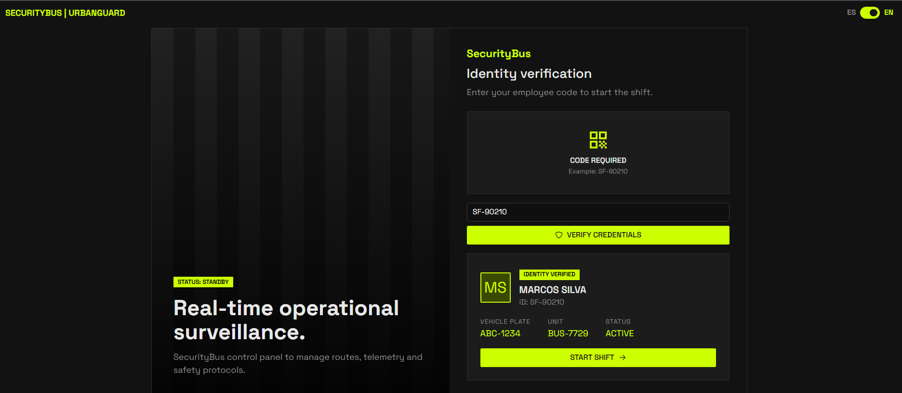

**Dashboard** <br>

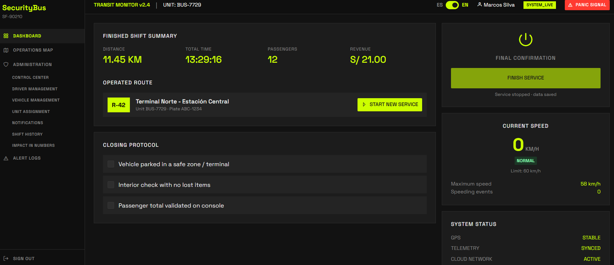

**Mapa** <br>

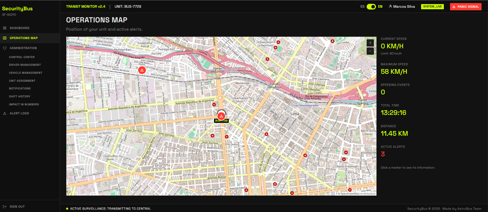

**Botón de pánico** <br>

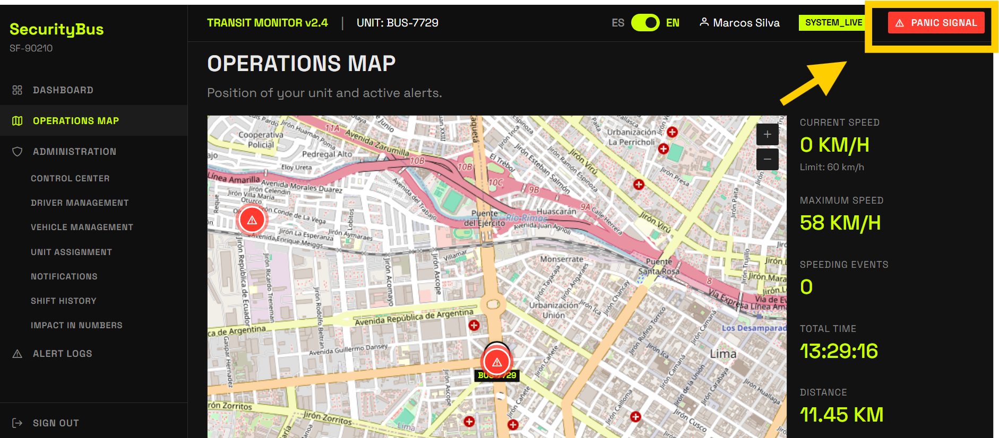

**Registro de alertas** <br>

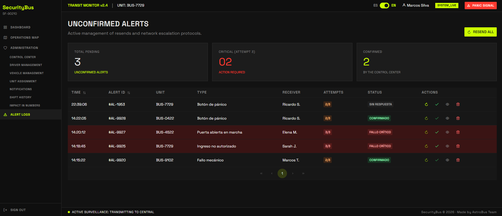

**Gestión de flotas** <br>

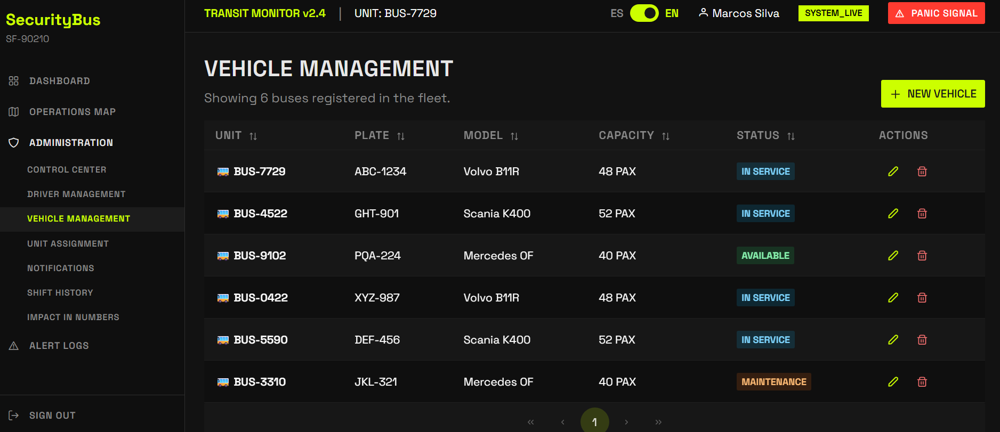

**Impacto en numeros** <br>

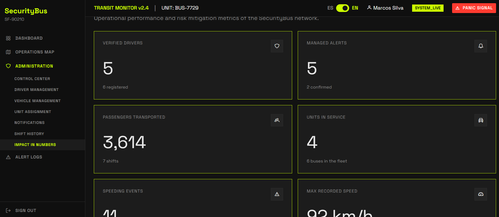

**Historial de turnos** <br>

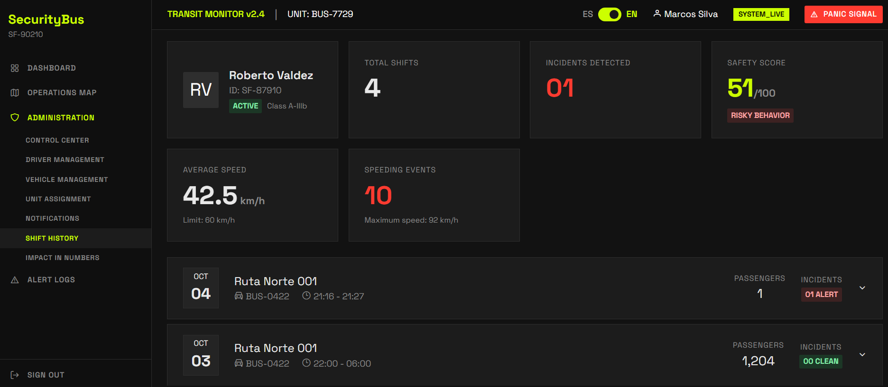

**Asignacion de unidades** <br>

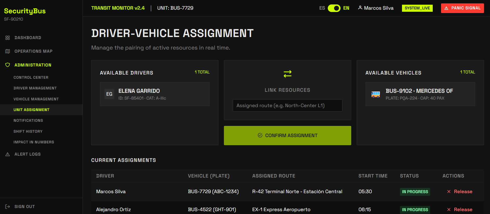

**Notificaciones** <br>

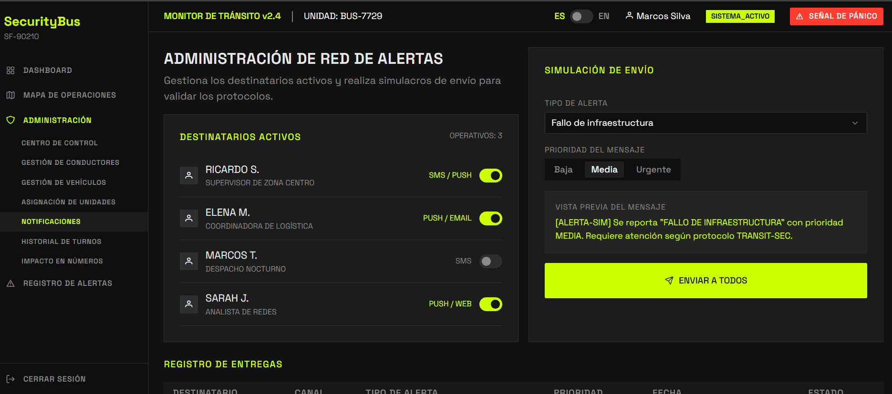

Para ilustrar la navegación completa se preparó un video de ejecución:

- Video de ejecución del Sprint 3: [https://upcedupe-my.sharepoint.com/personal/u202418823_upc_edu_pe/_layouts/15/stream.aspx?id=%2Fpersonal%2Fu202418823%5Fupc%5Fedu%5Fpe%2FDocuments%2FSecurity%20Bus%2Fabout%20the%20product%2Emp4&referrer=StreamWebApp%2EWeb&referrerScenario=AddressBarCopied%2Eview%2E17c5282c%2D68d4%2D477a%2Dac44%2De475636d3577](https://upcedupe-my.sharepoint.com/personal/u202418823_upc_edu_pe/_layouts/15/stream.aspx?id=%2Fpersonal%2Fu202418823%5Fupc%5Fedu%5Fpe%2FDocuments%2FSecurity%20Bus%2Fabout%20the%20product%2Emp4&referrer=StreamWebApp%2EWeb&referrerScenario=AddressBarCopied%2Eview%2E17c5282c%2D68d4%2D477a%2Dac44%2De475636d3577)

##### 5.2.3.6. Services Documentation Evidence for Sprint Review

La documentación de los servicios es el contrato entre el backend y quienes lo consumen. Una API sin documentación obliga a leer el código fuente para conocer sus rutas, parámetros y respuestas, lo que genera errores de integración y demoras. Por ello, el equipo documentó los Web Services desde su construcción, aprovechando la especificación OpenAPI que ASP.NET Core genera a partir de los controladores y de los recursos. Esta especificación se explora de forma interactiva mediante Scalar, herramienta que permite revisar la estructura de las rutas, los esquemas de datos y los parámetros requeridos, y probar los endpoints directamente desde el navegador.
 
En las siguientes líneas se detallan las convenciones adoptadas, los recursos expuestos y las operaciones disponibles en cada uno, de modo que cualquier desarrollador de la aplicación cliente pueda utilizarlos sin necesidad de consultar el código.
 
Todas las rutas utilizan el prefijo `/api/v1`, nombres en minúscula y notación kebab-case, y la documentación se encuentra disponible en todos los entornos. Además, el contenido de la documentación y los mensajes de validación se adaptan al idioma de la petición (español o inglés). En total, la API expone 66 operaciones distribuidas en 15 recursos.
 
- Repositorio del backend: [https://github.com/AstroBusTeam/AstroBusTeam-BackEnd](https://github.com/AstroBusTeam/AstroBusTeam-BackEnd)
- Repositorio del frontend: [https://github.com/AstroBusTeam/AstroBusTeam-FrontEnd](https://github.com/AstroBusTeam/AstroBusTeam-FrontEnd)
- Documentación interactiva: [https://securitybus-apg-api-hha7gwepbjhqg3b6.westus3-01.azurewebsites.net/scalar/](https://securitybus-apg-api-hha7gwepbjhqg3b6.westus3-01.azurewebsites.net/scalar/)

A continuación se presenta el registro completo de las operaciones implementadas, organizadas por módulo. En la columna de parámetros, el signo `?` indica un campo opcional; los nombres de los cuerpos (Body) corresponden a los recursos definidos en la capa de interfaces del backend.
 
**Módulo de Autenticación y Acceso (Authentication)**
 
Permite verificar la identidad del conductor antes de iniciar su jornada.
 
| Endpoint / Verbo HTTP | Descripción de la Acción | Parámetros Requeridos | Respuesta Esperada (JSON) |
|---|---|---|---|
| `POST`<br>`/api/v1/authentication/driver-verification` | Verifica que el código de empleado pertenezca a un conductor habilitado con asignación activa. | Body: VerifyDriverResource (employeeCode). | 200 OK<br>DriverIdentityResource (driverId, employeeCode, fullName, vehicleId, vehicleCode, route).<br>Errores: 400, 403, 404. |
 
**Módulo de Usuarios (Users)**
 
Gestiona las cuentas de acceso del sistema.
 
| Endpoint / Verbo HTTP | Descripción de la Acción | Parámetros Requeridos | Respuesta Esperada (JSON) |
|---|---|---|---|
| `POST`<br>`/api/v1/users` | Registra un nuevo usuario. | Body: CreateUserResource (username, password, role?, driverId?, active?). | 201 Created<br>UserResource (creado).<br>Errores: 400, 409. |
| `GET`<br>`/api/v1/users` | Lista usuarios registrados. | Ninguno. | 200 OK<br>Colección de UserResource. |
| `GET`<br>`/api/v1/users/{id}` | Obtiene los datos de un usuario según su identificador. | Path: id (integer). | 200 OK<br>UserResource.<br>404 si no existe. |
| `PUT`<br>`/api/v1/users/{id}` | Actualiza los datos de un usuario existente. | Path: id (integer).<br>Body: UpdateUserResource (username, role, active, password?, driverId?). | 200 OK<br>UserResource (actualizado).<br>Errores: 400, 404, 409. |
| `DELETE`<br>`/api/v1/users/{id}` | Elimina un usuario del sistema. | Path: id (integer). | 200 OK<br>Confirmación de eliminación.<br>404 si no existe. |
 
**Módulo de Gestión de Conductores (Drivers)**
 
Administra a los conductores de la empresa y su habilitación.
 
| Endpoint / Verbo HTTP | Descripción de la Acción | Parámetros Requeridos | Respuesta Esperada (JSON) |
|---|---|---|---|
| `POST`<br>`/api/v1/drivers` | Registra un nuevo conductor. | Body: CreateDriverResource (employeeCode, firstName, lastName, dni, licenseCategory, licenseNumber, licenseExpiry, points, rating, yearsExperience, status, phone?). | 201 Created<br>DriverResource (creado).<br>Errores: 400, 409. |
| `GET`<br>`/api/v1/drivers` | Lista los conductores o los filtra por código de empleado. | Query (opcional): employeeCode (string). | 200 OK<br>Colección de DriverResource. |
| `GET`<br>`/api/v1/drivers/{id}` | Obtiene los datos de un conductor según su identificador. | Path: id (integer). | 200 OK<br>DriverResource.<br>404 si no existe. |
| `PUT`<br>`/api/v1/drivers/{id}` | Actualiza los datos de un conductor existente. | Path: id (integer).<br>Body: UpdateDriverResource (mismos campos que la creación). | 200 OK<br>DriverResource (actualizado).<br>Errores: 400, 404, 409. |
| `DELETE`<br>`/api/v1/drivers/{id}` | Elimina un conductor del sistema. | Path: id (integer). | 200 OK<br>Confirmación de eliminación.<br>404 si no existe. |
 
**Módulo de Gestión de Vehículos (Vehicles)**
 
Administra las unidades de la flota y su posición actual.
 
| Endpoint / Verbo HTTP | Descripción de la Acción | Parámetros Requeridos | Respuesta Esperada (JSON) |
|---|---|---|---|
| `POST`<br>`/api/v1/vehicles` | Registra un nuevo vehículo. | Body: CreateVehicleResource (code, plate, model, capacity, status, currentLatitude, currentLongitude). | 201 Created<br>VehicleResource (creado).<br>Errores: 400, 409. |
| `GET`<br>`/api/v1/vehicles` | Lista los vehículos de la flota. | Ninguno. | 200 OK<br>Colección de VehicleResource. |
| `GET`<br>`/api/v1/vehicles/{id}` | Obtiene los datos de un vehículo según su identificador. | Path: id (integer). | 200 OK<br>VehicleResource.<br>404 si no existe. |
| `PUT`<br>`/api/v1/vehicles/{id}` | Actualiza los datos de un vehículo existente. | Path: id (integer).<br>Body: UpdateVehicleResource (mismos campos que la creación). | 200 OK<br>VehicleResource (actualizado).<br>Errores: 400, 404, 409. |
| `DELETE`<br>`/api/v1/vehicles/{id}` | Elimina un vehículo del sistema. | Path: id (integer). | 200 OK<br>Confirmación de eliminación.<br>404 si no existe. |
 
**Módulo de Rutas (Routes)**
 
Define las rutas de servicio de la empresa.
 
| Endpoint / Verbo HTTP | Descripción de la Acción | Parámetros Requeridos | Respuesta Esperada (JSON) |
|---|---|---|---|
| `POST`<br>`/api/v1/routes` | Registra una nueva ruta. | Body: CreateBusRouteResource (code, name, origin, destination, distanceKm?, active?). | 201 Created<br>BusRouteResource (creada).<br>Errores: 400, 409. |
| `GET`<br>`/api/v1/routes` | Lista las rutas registradas. | Ninguno. | 200 OK<br>Colección de BusRouteResource. |
| `GET`<br>`/api/v1/routes/{id}` | Obtiene los datos de una ruta según su identificador. | Path: id (integer). | 200 OK<br>BusRouteResource.<br>404 si no existe. |
| `PUT`<br>`/api/v1/routes/{id}` | Actualiza los datos de una ruta existente. | Path: id (integer).<br>Body: UpdateBusRouteResource (code, name, origin, destination, distanceKm, active). | 200 OK<br>BusRouteResource (actualizada).<br>Errores: 400, 404, 409. |
| `DELETE`<br>`/api/v1/routes/{id}` | Elimina una ruta del sistema. | Path: id (integer). | 200 OK<br>Confirmación de eliminación.<br>404 si no existe. |
 
**Módulo de Asignaciones (Assignments)**
 
Vincula a un conductor con una unidad y una ruta.
 
| Endpoint / Verbo HTTP | Descripción de la Acción | Parámetros Requeridos | Respuesta Esperada (JSON) |
|---|---|---|---|
| `POST`<br>`/api/v1/assignments` | Registra una nueva asignación. | Body: CreateAssignmentResource (driverId, vehicleId, routeId, startTime, status, validFrom?, validTo?, assignedBy?). | 201 Created<br>AssignmentResource (creada).<br>Errores: 400, 409. |
| `GET`<br>`/api/v1/assignments` | Lista las asignaciones o las filtra por conductor y estado. | Query (opcional): driverId (integer), status (string). | 200 OK<br>Colección de AssignmentResource. |
| `GET`<br>`/api/v1/assignments/{id}` | Obtiene los datos de una asignación según su identificador. | Path: id (integer). | 200 OK<br>AssignmentResource.<br>404 si no existe. |
| `PUT`<br>`/api/v1/assignments/{id}` | Actualiza los datos de una asignación existente. | Path: id (integer).<br>Body: UpdateAssignmentResource (status, validTo?). | 200 OK<br>AssignmentResource (actualizada).<br>Errores: 400, 404, 409. |
| `DELETE`<br>`/api/v1/assignments/{id}` | Elimina una asignación del sistema. | Path: id (integer). | 200 OK<br>Confirmación de eliminación.<br>404 si no existe. |
 
**Módulo de Turnos de Servicio (Shifts)**
 
Registra la apertura, el seguimiento y el cierre del servicio de cada conductor.
 
| Endpoint / Verbo HTTP | Descripción de la Acción | Parámetros Requeridos | Respuesta Esperada (JSON) |
|---|---|---|---|
| `POST`<br>`/api/v1/shifts` | Registra un nuevo turno. | Body: CreateShiftResource (assignmentId, driverId, vehicleId, routeId, shiftDate?, startTime?, endTime?, distanceKm?, passengers?, revenue?, status?, averageSpeedKmh?, maxSpeedKmh?, overspeedEvents?). | 201 Created<br>ShiftResource (creado).<br>Errores: 400, 409. |
| `GET`<br>`/api/v1/shifts` | Lista los turnos o los filtra por conductor. | Query (opcional): driverId (integer). | 200 OK<br>Colección de ShiftResource. |
| `GET`<br>`/api/v1/shifts/{id}` | Obtiene los datos de un turno según su identificador. | Path: id (integer). | 200 OK<br>ShiftResource.<br>404 si no existe. |
| `PUT`<br>`/api/v1/shifts/{id}` | Actualiza los datos de un turno existente. | Path: id (integer).<br>Body: UpdateShiftResource (assignmentId, driverId, vehicleId, routeId, shiftDate, startTime, distanceKm, passengers, revenue, status, averageSpeedKmh, maxSpeedKmh, overspeedEvents, endTime?). | 200 OK<br>ShiftResource (actualizado).<br>Errores: 400, 404, 409. |
 
**Módulo de Posiciones de Vehículos (VehiclePositions)**
 
Almacena las posiciones GPS reportadas por las unidades.
 
| Endpoint / Verbo HTTP | Descripción de la Acción | Parámetros Requeridos | Respuesta Esperada (JSON) |
|---|---|---|---|
| `POST`<br>`/api/v1/vehicle-positions` | Registra una nueva posición. | Body: CreateVehiclePositionResource (vehicleId, latitude, longitude, shiftId?, speedKmh?, recordedAt?). | 201 Created<br>VehiclePositionResource (creada).<br>Errores: 400, 409. |
| `GET`<br>`/api/v1/vehicle-positions` | Lista las posiciones o las filtra por vehículo y turno. | Query (opcional): vehicleId (integer), shiftId (integer). | 200 OK<br>Colección de VehiclePositionResource. |
| `GET`<br>`/api/v1/vehicle-positions/{id}` | Obtiene los datos de una posición según su identificador. | Path: id (integer). | 200 OK<br>VehiclePositionResource.<br>404 si no existe. |
| `PUT`<br>`/api/v1/vehicle-positions/{id}` | Actualiza los datos de una posición existente. | Path: id (integer).<br>Body: UpdateVehiclePositionResource (vehicleId, latitude, longitude, speedKmh, recordedAt, shiftId?). | 200 OK<br>VehiclePositionResource (actualizada).<br>Errores: 400, 404, 409. |
| `DELETE`<br>`/api/v1/vehicle-positions/{id}` | Elimina una posición del sistema. | Path: id (integer). | 200 OK<br>Confirmación de eliminación.<br>404 si no existe. |
 
**Módulo de Alertas (Alerts)**
 
Gestiona las alertas de emergencia emitidas por los conductores.
 
| Endpoint / Verbo HTTP | Descripción de la Acción | Parámetros Requeridos | Respuesta Esperada (JSON) |
|---|---|---|---|
| `POST`<br>`/api/v1/alerts` | Registra una nueva alerta. | Body: CreateAlertResource (vehicleId, alertTypeId, receiverId, latitude, longitude, driverId?, shiftId?, code?, attempts?, status?, createdAt?, confirmedAt?, confirmedBy?, notes?). | 201 Created<br>AlertResource (creada).<br>Errores: 400, 409. |
| `GET`<br>`/api/v1/alerts` | Lista las alertas o las filtra por estado. | Query (opcional): status (string). | 200 OK<br>Colección de AlertResource. |
| `GET`<br>`/api/v1/alerts/{id}` | Obtiene los datos de una alerta según su identificador. | Path: id (integer). | 200 OK<br>AlertResource.<br>404 si no existe. |
| `PUT`<br>`/api/v1/alerts/{id}` | Actualiza los datos de una alerta existente. | Path: id (integer).<br>Body: UpdateAlertResource (code, vehicleId, alertTypeId, receiverId, attempts, status, createdAt, latitude, longitude, driverId?, shiftId?, confirmedAt?, confirmedBy?, notes?). | 200 OK<br>AlertResource (actualizada).<br>Errores: 400, 404, 409. |
| `DELETE`<br>`/api/v1/alerts/{id}` | Elimina una alerta del sistema. | Path: id (integer). | 200 OK<br>Confirmación de eliminación.<br>404 si no existe. |
 
**Módulo de Tipos de Alerta (AlertTypes)**
 
Mantiene el catálogo de tipos de alerta y su prioridad.
 
| Endpoint / Verbo HTTP | Descripción de la Acción | Parámetros Requeridos | Respuesta Esperada (JSON) |
|---|---|---|---|
| `POST`<br>`/api/v1/alert-types` | Registra un nuevo tipo de alerta. | Body: CreateAlertTypeResource (name, defaultPriority?, isPanic?). | 201 Created<br>AlertTypeResource (creado).<br>Errores: 400, 409. |
| `GET`<br>`/api/v1/alert-types` | Lista tipos de alerta registrados. | Ninguno. | 200 OK<br>Colección de AlertTypeResource. |
| `GET`<br>`/api/v1/alert-types/{id}` | Obtiene los datos de un tipo de alerta según su identificador. | Path: id (integer). | 200 OK<br>AlertTypeResource.<br>404 si no existe. |
| `PUT`<br>`/api/v1/alert-types/{id}` | Actualiza los datos de un tipo de alerta existente. | Path: id (integer).<br>Body: UpdateAlertTypeResource (name, defaultPriority, isPanic). | 200 OK<br>AlertTypeResource (actualizado).<br>Errores: 400, 404, 409. |
| `DELETE`<br>`/api/v1/alert-types/{id}` | Elimina un tipo de alerta del sistema. | Path: id (integer). | 200 OK<br>Confirmación de eliminación.<br>404 si no existe. |
 
**Módulo de Intentos de Envío (AlertAttempts)**
 
Registra cada intento de envío de una alerta a la central.
 
| Endpoint / Verbo HTTP | Descripción de la Acción | Parámetros Requeridos | Respuesta Esperada (JSON) |
|---|---|---|---|
| `POST`<br>`/api/v1/alert-attempts` | Registra un nuevo intento de envío. | Body: CreateAlertAttemptResource (alertId, attemptNumber, sentAt?, result?). | 201 Created<br>AlertAttemptResource (creado).<br>Errores: 400, 409. |
| `GET`<br>`/api/v1/alert-attempts` | Lista los intentos de envío o los filtra por alerta. | Query (opcional): alertId (integer). | 200 OK<br>Colección de AlertAttemptResource. |
| `GET`<br>`/api/v1/alert-attempts/{id}` | Obtiene los datos de un intento de envío según su identificador. | Path: id (integer). | 200 OK<br>AlertAttemptResource.<br>404 si no existe. |
| `PUT`<br>`/api/v1/alert-attempts/{id}` | Actualiza los datos de un intento de envío existente. | Path: id (integer).<br>Body: UpdateAlertAttemptResource (alertId, attemptNumber, sentAt, result). | 200 OK<br>AlertAttemptResource (actualizado).<br>Errores: 400, 404, 409. |
| `DELETE`<br>`/api/v1/alert-attempts/{id}` | Elimina un intento de envío del sistema. | Path: id (integer). | 200 OK<br>Confirmación de eliminación.<br>404 si no existe. |
 
**Módulo de Entregas de Notificaciones (Deliveries)**
 
Registra las entregas de las alertas a sus destinatarios por cada canal.
 
| Endpoint / Verbo HTTP | Descripción de la Acción | Parámetros Requeridos | Respuesta Esperada (JSON) |
|---|---|---|---|
| `POST`<br>`/api/v1/deliveries` | Registra una nueva entrega. | Body: CreateDeliveryResource (alertId, recipientId, channelId, alertTypeId, priority, status?, sentAt?, errorMessage?). | 201 Created<br>DeliveryResource (creada).<br>Errores: 400, 409. |
| `GET`<br>`/api/v1/deliveries` | Lista las entregas de notificaciones. | Ninguno. | 200 OK<br>Colección de DeliveryResource. |
| `GET`<br>`/api/v1/deliveries/{id}` | Obtiene los datos de una entrega según su identificador. | Path: id (integer). | 200 OK<br>DeliveryResource.<br>404 si no existe. |
 
**Módulo de Destinatarios (Recipients)**
 
Consulta y actualiza a las personas que reciben las alertas.
 
| Endpoint / Verbo HTTP | Descripción de la Acción | Parámetros Requeridos | Respuesta Esperada (JSON) |
|---|---|---|---|
| `GET`<br>`/api/v1/recipients` | Lista los destinatarios de las alertas. | Ninguno. | 200 OK<br>Colección de RecipientResource. |
| `GET`<br>`/api/v1/recipients/{id}` | Obtiene los datos de un destinatario según su identificador. | Path: id (integer). | 200 OK<br>RecipientResource.<br>404 si no existe. |
| `PUT`<br>`/api/v1/recipients/{id}` | Actualiza los datos de un destinatario existente. | Path: id (integer).<br>Body: UpdateRecipientResource (name, role, active, email?, phone?, controlCenterId?, channelIds?). | 200 OK<br>RecipientResource (actualizado).<br>Errores: 400, 404, 409. |
 
**Módulo de Canales de Notificación (NotificationChannels)**
 
Mantiene los canales por los que se notifican las alertas.
 
| Endpoint / Verbo HTTP | Descripción de la Acción | Parámetros Requeridos | Respuesta Esperada (JSON) |
|---|---|---|---|
| `POST`<br>`/api/v1/notification-channels` | Registra un nuevo canal de notificación. | Body: CreateNotificationChannelResource (code). | 201 Created<br>NotificationChannelResource (creado).<br>Errores: 400, 409. |
| `GET`<br>`/api/v1/notification-channels` | Lista canales de notificación registrados. | Ninguno. | 200 OK<br>Colección de NotificationChannelResource. |
| `GET`<br>`/api/v1/notification-channels/{id}` | Obtiene los datos de un canal de notificación según su identificador. | Path: id (integer). | 200 OK<br>NotificationChannelResource.<br>404 si no existe. |
| `PUT`<br>`/api/v1/notification-channels/{id}` | Actualiza los datos de un canal de notificación existente. | Path: id (integer).<br>Body: UpdateNotificationChannelResource (code). | 200 OK<br>NotificationChannelResource (actualizado).<br>Errores: 400, 404, 409. |
| `DELETE`<br>`/api/v1/notification-channels/{id}` | Elimina un canal de notificación del sistema. | Path: id (integer). | 200 OK<br>Confirmación de eliminación.<br>404 si no existe. |
 
**Módulo de Centros de Control (ControlCenters)**
 
Administra los centros de control que supervisan la operación.
 
| Endpoint / Verbo HTTP | Descripción de la Acción | Parámetros Requeridos | Respuesta Esperada (JSON) |
|---|---|---|---|
| `POST`<br>`/api/v1/control-centers` | Registra un nuevo centro de control. | Body: CreateControlCenterResource (code, name, zone, active?). | 201 Created<br>ControlCenterResource (creado).<br>Errores: 400, 409. |
| `GET`<br>`/api/v1/control-centers` | Lista centros de control registrados. | Ninguno. | 200 OK<br>Colección de ControlCenterResource. |
| `GET`<br>`/api/v1/control-centers/{id}` | Obtiene los datos de un centro de control según su identificador. | Path: id (integer). | 200 OK<br>ControlCenterResource.<br>404 si no existe. |
| `PUT`<br>`/api/v1/control-centers/{id}` | Actualiza los datos de un centro de control existente. | Path: id (integer).<br>Body: UpdateControlCenterResource (code, name, zone, active). | 200 OK<br>ControlCenterResource (actualizado).<br>Errores: 400, 404, 409. |
| `DELETE`<br>`/api/v1/control-centers/{id}` | Elimina un centro de control del sistema. | Path: id (integer). | 200 OK<br>Confirmación de eliminación.<br>404 si no existe. |
 
 
**Códigos de respuesta.** Las respuestas siguen una convención uniforme: `200` o `201` ante una operación exitosa (las eliminaciones responden `200`), `400` por errores de validación (con `ProblemDetails` localizado), `404` cuando el recurso no existe, `409` ante conflictos por duplicados y `500` con un `ProblemDetails` genérico ante fallas inesperadas.
 
**Ejemplo de uso: apertura de un servicio (TS02).** Para abrir el turno de un conductor se envía una petición `POST /api/v1/shifts` con los identificadores de su asignación, conductor, vehículo y ruta:
 
```json
{
  "assignmentId": 1,
  "driverId": 1,
  "vehicleId": 1,
  "routeId": 1,
  "status": "active",
  "startTime": "2026-11-08T08:00:00"
}
```
 
La respuesta (`201 Created`) devuelve el turno registrado, con su identificador y los campos calculados por el backend: `id`, `shiftDate`, `startTime`, `endTime`, `distanceKm`, `passengers`, `revenue`, `status`, `averageSpeedKmh`, `maxSpeedKmh` y `overspeedEvents`.
 
**Ejemplo de uso: verificación del conductor (TS01).** El servicio `POST /api/v1/authentication/driver-verification` recibe el código de empleado y devuelve la identidad del conductor con su unidad y su ruta (los valores del ejemplo son ilustrativos):
 
```json
{ "employeeCode": "SF-90210" }
```
 
```json
{
  "driverId": 1,
  "employeeCode": "SF-90210",
  "fullName": "…",
  "vehicleId": 1,
  "vehicleCode": "…",
  "route": "…"
}
```
 
Si el código no existe, el conductor no está activo, no tiene una asignación vigente o su vehículo no existe, el servicio responde con un `ProblemDetails` y los códigos `404` o `403` según el caso.

<center> Vista General de los Endpoints Documentados </center> <br>

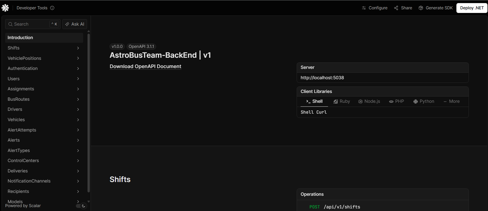 <br>

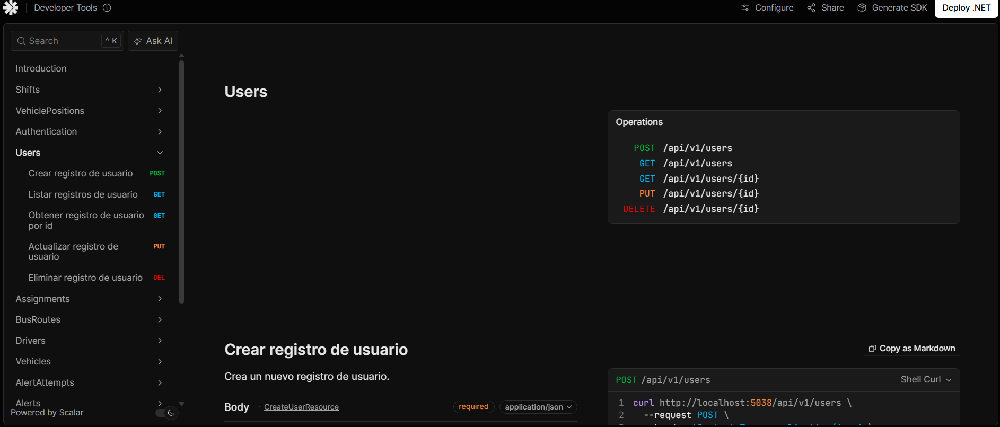 <br>

<center> Detalle de Parámetros y Esquemas en Endpoint POST </center> <br>

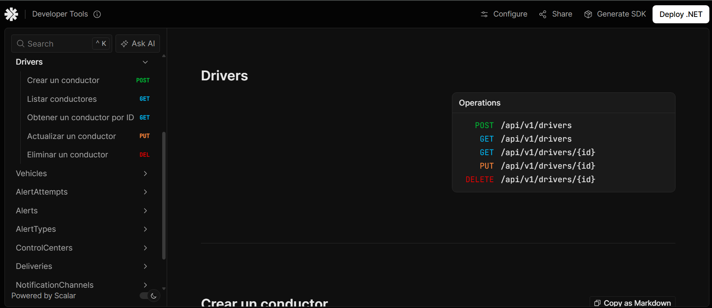 <br>

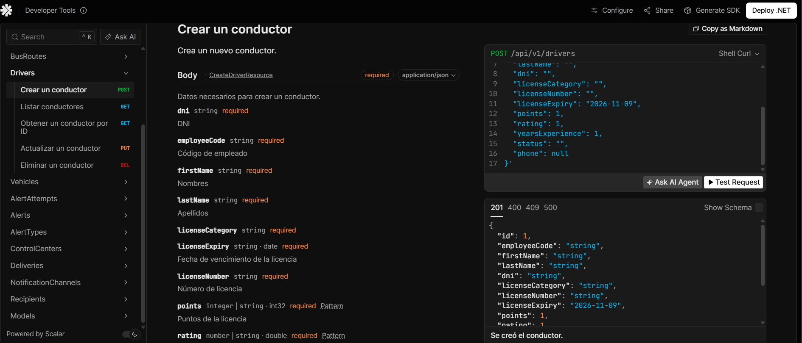 <br>

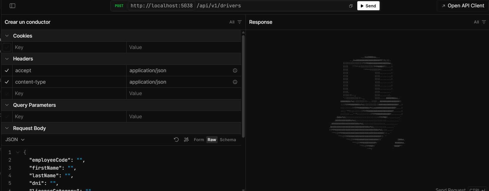 <br>

<center> Prueba de Ejecución (Try it out) e Interacción con el API </center> <br>

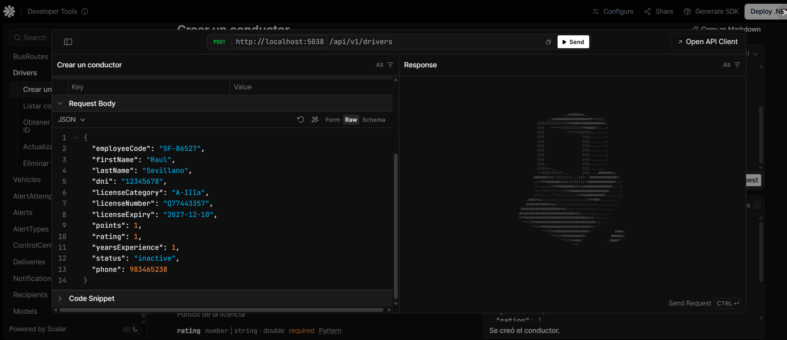 <br>
 
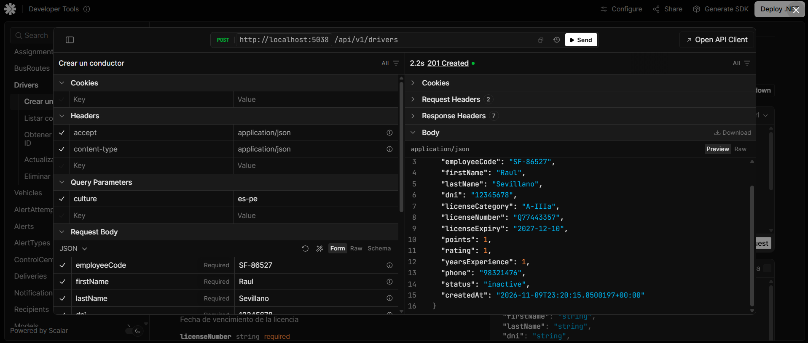 <br>


##### 5.2.3.7. Software Deployment Evidence for Sprint Review

El despliegue es la actividad que pone el producto a disposición de sus usuarios fuera del entorno de desarrollo. En el Sprint 3 el reto principal consistió en publicar el backend junto con su base de datos y conectarlo con la aplicación web ya publicada, garantizando que las credenciales y la configuración sensible no se almacenaran en el repositorio. En este apartado se identifican los componentes desplegados y la plataforma que aloja a cada uno, se describe paso a paso el proceso seguido para el frontend y para el backend, y se presentan las evidencias gráficas de que los componentes se encuentran activos.
 
**A. Componentes desplegados y entornos cloud**
 
La solución se distribuye en cuatro componentes alojados en plataformas distintas, de acuerdo con las necesidades de cada uno: un sitio estático para la Landing Page, una aplicación web estática para el frontend, una aplicación de servidor para los Web Services y una base de datos administrada para la persistencia.
 
| Componente | Plataforma | Descripción | URL |
|---|---|---|---|
| Landing Page | GitHub Pages | Sitio estático de presentación del producto | https://github.com/AstroBusTeam/SecurityBus-landing-page-aw |
| Web Application (Frontend) | Firebase Hosting | Aplicación Vue 3 compilada con Vite y publicada como sitio estático | https://securitybus-730-aw-front-7bf31.web.app |
| Web Services (Backend) | Microsoft Azure – Web App Linux (.NET 10) | API REST en ASP.NET Core con documentación Scalar | https://securitybus-apg-api-hha7gwepbjhqg3b6.westus3-01.azurewebsites.net/scalar/ |
| Base de datos | Azure Database for MySQL – servidor flexible | Base de datos relacional del backend | No público |
 
Dado que el frontend y el backend se publican en dominios distintos, el navegador aplica la política de mismo origen, por lo que fue necesario habilitar explícitamente las peticiones entre ambos mediante CORS. Del mismo modo, la cadena de conexión a la base de datos se inyecta mediante variables de entorno para no exponer credenciales en el código fuente.
 
**B. Configuración paso a paso del proceso de despliegue**
 
*B.1. Despliegue del backend en Microsoft Azure*
 
El backend se ejecuta en una Web App Linux de Azure y se comunica con un servidor MySQL administrado. El proceso se llevó a cabo en los siguientes pasos:
 
**Paso 1: Preparación de la cuenta y selección de regiones.** Se utilizó la suscripción Azure for Students. Esta suscripción restringe las regiones disponibles (Brazil South, West US 3, Chile Central, México Central y North Central US), por lo que el equipo ubicó cada recurso en una de ellas: la Web App en West US 3 y la base de datos en Chile Central.
 
**Paso 2: Creación del grupo de recursos.** Se creó el grupo `securitybus-rg`, que agrupa todos los recursos del backend y permite administrarlos o eliminarlos conjuntamente.
 
**Paso 3: Creación del servidor MySQL.** Dentro del grupo de recursos se creó un servidor MySQL de tipo flexible llamado `securitybus-apg-db` en la región Chile Central, con su usuario administrador y su base de datos para el esquema de la aplicación. Se habilitó el acceso desde los servicios de Azure mediante la regla de red «Permitir el acceso público desde cualquier servicio de Azure», de modo que la Web App pueda conectarse al servidor. Para permitir la consulta directa de los datos desde MySQL Workbench durante el desarrollo, se agregó además una regla de firewall por cada integrante, con su dirección IP pública, desde la sección Networking del servidor.
 
**Paso 4: Creación de la Web App.** Se creó la aplicación web `securitybus-apg-api` con sistema operativo Linux, pila de ejecución .NET 10 y región West US 3.
 
**Paso 5: Configuración de las variables de entorno.** En la sección de configuración de la Web App se registraron las variables que reemplazan a los valores de desarrollo del archivo `appsettings.Production.json`: `DATABASE_URL` (servidor), `DATABASE_USER` (usuario), `DATABASE_SCHEMA` (esquema) y la clave de acceso. De este modo, ningún secreto se almacena en el repositorio. La carga de datos de ejemplo permanece desactivada en producción (`Database:SeedSampleData = false`).
 
**Paso 6: Configuración de CORS.** En `appsettings` se definió `Cors:AllowedOrigins` con los orígenes autorizados: `http://localhost:5173` (desarrollo) y los dominios de Firebase Hosting (`.web.app` y `.firebaseapp.com`). El backend aplica esta política mediante la política denominada «Frontend».
 
**Paso 7: Compilación y publicación.** Se compiló el proyecto en modo Release (`dotnet publish -c Release`), se comprimió el resultado en un archivo zip y se subió a Azure Cloud Shell. Desde allí se desplegó el paquete en la Web App con la herramienta de línea de comandos de Azure (`az webapp deploy --resource-group securitybus-rg --name securitybus-apg-api --src-path SecurityBus-API.zip --type zip`).
 
**Paso 8: Creación del esquema y verificación.** Al iniciar, la aplicación ejecuta `EnsureCreated()`, que crea las tablas y la vista `v_shift_summary` en la base de datos. Para verificar el despliegue se abrió la documentación Scalar de la Web App y se ejecutó una consulta de prueba (por ejemplo, `GET /api/v1/drivers`), que respondió correctamente.
 
*B.2. Despliegue del frontend en Firebase Hosting*
 
**Paso 1: Configuración de la URL del backend.** En el archivo `.env.production` se definió la variable `VITE_SAFEBUS_API_URL` con la URL de la Web App de Azure seguida del prefijo `/api/v1`.
 
**Paso 2: Instalación de dependencias y compilación.** Se ejecutó `npm install` y luego `npm run build`, que genera la carpeta `dist` con los archivos estáticos optimizados.
 
**Paso 3: Configuración de Firebase.** El proyecto de Firebase es `securitybus-730-aw-front-7bf31` (archivo `.firebaserc`). En `firebase.json` se indicó `dist` como carpeta pública y se definió una regla de reescritura que redirige todas las rutas a `/index.html`. Esta regla es necesaria porque la aplicación es de página única: sin ella, al recargar una ruta interna (por ejemplo, `/alerts/logs`) el servidor respondería con un error 404.
 
**Paso 4: Publicación.** Se ejecutó `firebase deploy --only hosting`, que sube el contenido de `dist` y lo publica en el dominio `securitybus-730-aw-front-7bf31.firebaseapp.com`.
 
*B.3. Landing Page en GitHub Pages*
 
La Landing Page se aloja en el repositorio `SecurityBus-landing-page-aw`. En la configuración del repositorio (*Settings → Pages*) se seleccionó como fuente la rama principal y la carpeta raíz, con lo que GitHub Pages publica automáticamente el HTML, CSS y JavaScript cada vez que se integra un cambio en esa rama.

*B.4. Conexión a la base de datos y configuración del equipo*

Con el fin de verificar los datos almacenados por la aplicación desplegada, se configuró el acceso al servidor MySQL de Azure desde MySQL Workbench.

Paso 1: Autorización de acceso. En la sección Networking del servidor securitybus-apg-db se agregó una regla de firewall con la IP pública de cada integrante.

Paso 2: Creación de la conexión. En MySQL Workbench se creó la conexión «Azure SecurityBus» con el host del servidor, el puerto 3306, el usuario administrador, el esquema securitybus y SSL en modo Require.

Paso 3: Verificación. Se ejecutó la consulta SELECT * FROM drivers; y se comprobó que los registros guardados corresponden a los que devuelve GET /api/v1/drivers en la documentación Scalar de producción.

Paso 4: Configuración local del equipo. Cada integrante definió su cadena de conexión en el archivo appsettings.Development.json, excluido del repositorio mediante .gitignore, de modo que ninguna credencial se almacena en el control de versiones. Con esta configuración, el backend ejecutado desde Rider utiliza el mismo esquema que la aplicación desplegada.
 
**C. Evidencias gráficas de despliegue**

Las siguientes capturas permiten verificar que los componentes se encuentran activos y correctamente configurados.

<center> Grupo de recursos `securitybus-rg` en Azure </center> <br>

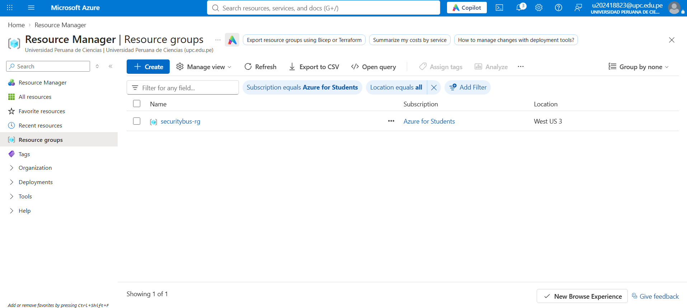 <br>

<center> Web App `securitybus-apg-api` </center> <br>

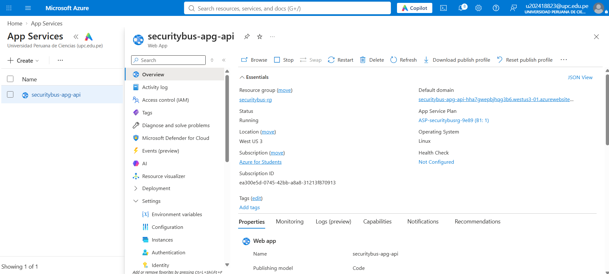 <br>

<center> Variables de entorno de la Web App </center> <br>

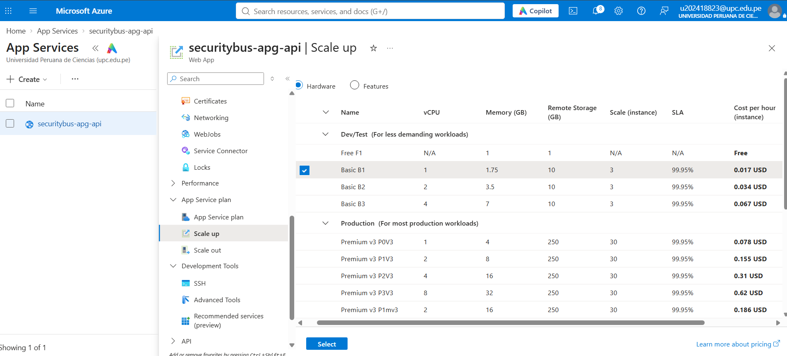 <br>

<center> Servidor MySQL `securitybus-apg-db` </center> <br>

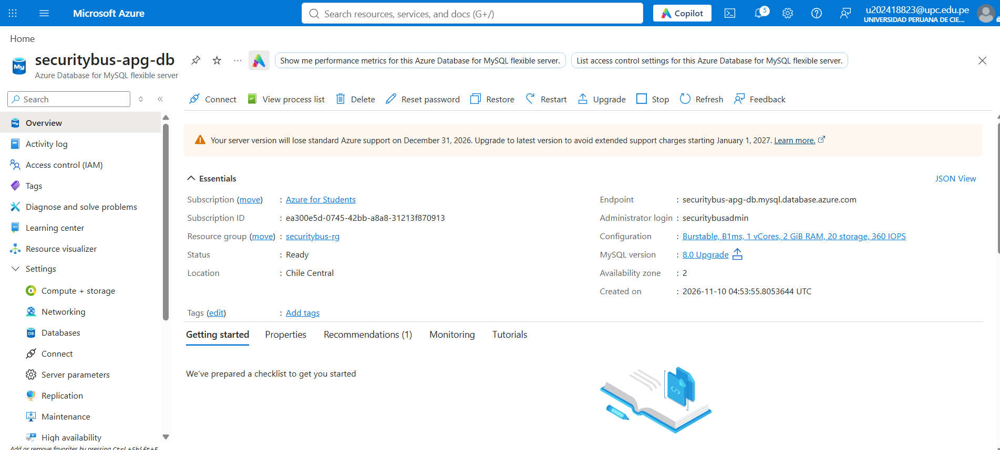 <br>

<center> Documentación Scalar en producción </center> <br>

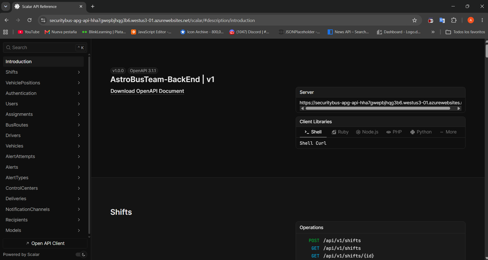 <br>

<center> Reglas de firewall del servidor MySQL </center> <br>

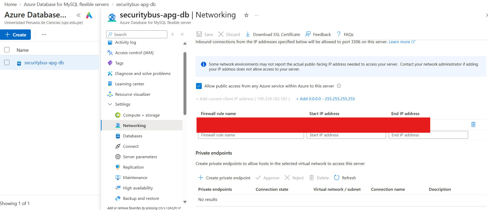 <br>

<center> Conexión Azure SecurityBus configurada en MySQL Workbench </center> <br>

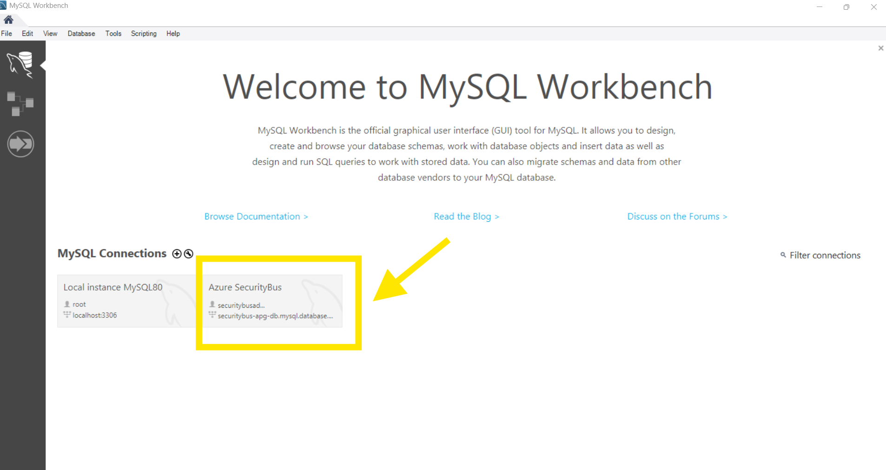 <br>

<center> Esquema securitybus y tabla drivers consultados desde MySQL Workbench </center> <br>

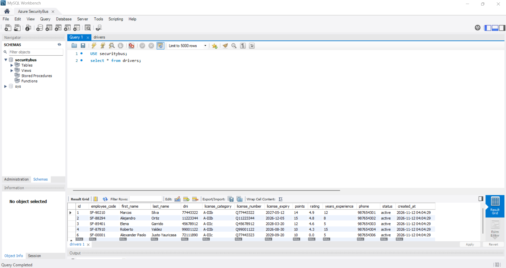 <br>

<center> Prueba en Scalar de producción: operación sobre drivers y su reflejo en la base de datos </center> <br>

 <br>

 <br>

<center> Frontend publicado en Firebase Hosting </center> <br>

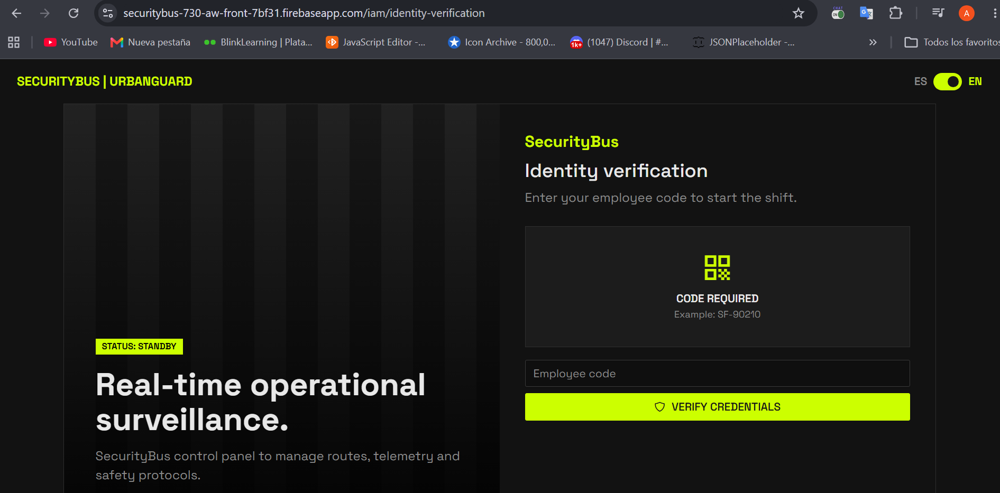 <br>

<center> Aplicación web consumiendo el backend desplegado </center> <br>

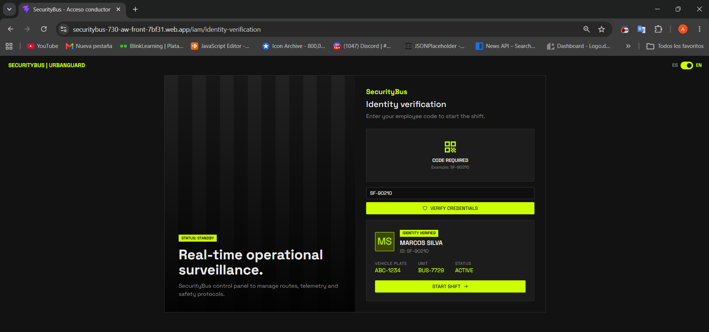 <br>

<center> Configuración de GitHub Pages de la Landing Page (Settings > Pages) </center> <br>

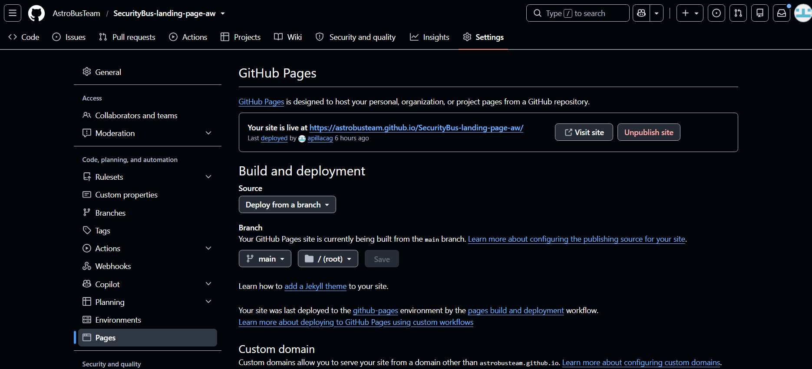 <br>

<center> Landing Page publicada </center> <br>

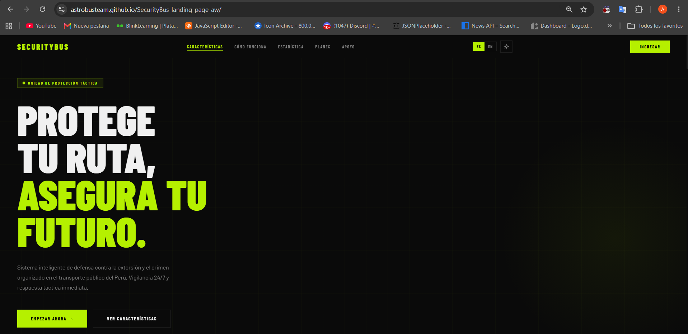 <br>

##### 5.2.3.8. Team Collaboration Insights during Sprint

El trabajo colaborativo es uno de los pilares del desarrollo de software en equipo. Más allá de la cantidad de código producido, interesa evidenciar que el equipo se organizó, revisó mutuamente sus cambios y mantuvo un historial ordenado que permita reconstruir las decisiones tomadas. En esta sección se describe la estrategia de ramas y de integración empleada durante el Sprint 3, el aporte de cada integrante y las analíticas extraídas de los repositorios que respaldan dicha participación.
 
Durante el Sprint 3 se mantuvo la estrategia GitFlow definida en la configuración del proyecto. Cada bounded context se desarrolló en una rama propia (`feature/shared`, `feature/fleet-bounded-context`, `feat/iam`, `feature/alerts`, `feature/operation` y `feature/internationalization`), creada a partir de `develop`, y sus cambios se integraron mediante Pull Requests, que permitieron revisar el código antes de incorporarlo. Tras su verificación, los cambios de `develop` se integraron en `main`. Los commits siguieron la convención Conventional Commits (`feat`, `fix`, `docs`, `chore`, `revert`), lo que facilita rastrear el propósito de cada cambio. El repositorio del backend registra 77 commits entre el 05 y el 08 de noviembre, repartidos entre los cinco integrantes, y el equipo mantuvo además un trabajo continuo sobre el frontend para su integración y documentación.
 
| Integrante | Aporte principal en el backend |
|---|---|
| Andy Pillaca (apillacag) | Estructura del proyecto, bounded context Alerts, internacionalización, cadena de conexión y despliegue |
| Boris Alvarado (borisalvaradomillanPE) | Shared: modelo base, repositorio, Unit of Work, `AppDbContext`, datos de ejemplo y OpenAPI localizado |
| Bryan Martinez (BryanMR1) | Fleet: agregados, servicios, repositorios, controladores y fachada ACL |
| Alexander Justo (AlexanderJusto) | Operations: dominio, aplicación, infraestructura e interfaces |
| Ian Nawrocki | IAM: verificación de la identidad del conductor |

Las evidencias muestran que todos los integrantes participaron en el desarrollo, con commits distribuidos a lo largo del Sprint e integraciones frecuentes hacia la rama `develop`. Entre las actividades colaborativas más relevantes destacan:
 
- Desarrollo conjunto de los bounded contexts del backend (Shared, Fleet, Operations, Alerts e IAM) bajo la arquitectura DDD.
- Implementación de la persistencia relacional con Entity Framework Core y carga de datos de ejemplo.
- Documentación interactiva de los endpoints con OpenAPI y Scalar, y localización de la API en español e inglés.
- Adaptación del frontend para consumir los Web Services y reemplazar la Fake API.
- Configuración de CORS, variables de entorno y despliegue del backend en Azure.
- Documentación del código del frontend para facilitar su mantenimiento.

Repositorio del backend: https://github.com/AstroBusTeam/AstroBusTeam-BackEnd
 
Repositorio del frontend: https://github.com/AstroBusTeam/AstroBusTeam-FrontEnd

<center> Evidencia 1: Gráfico de contribuciones por integrante del equipo </center> <br>

 <br>

<center> Evidencia 2: Resumen de actividad del Sprint mediante GitHub Pulse </center> <br>

 <br>

<center> Evidencia 3: Gestión colaborativa mediante Pull Requests y merges </center> <br>

 <br>

<center> Evidencia 4: Organización de ramas bajo estrategia GitFlow </center> <br>

 <br>

<center> Evidencia 5: Gráfico de contribuciones del frontend </center> <br>

 <br>

Actividades colaborativas más relevantes:

• Diseño de los contextos Iam, Fleet, Operations y Alerts bajo Domain-Driven Design.
• Persistencia con Entity Framework Core, claves foráneas, auditoría y Unit of Work.
• Documentación de los endpoints con OpenAPI y Scalar en español e inglés.
• Localización de los mensajes de error de la API.
• Adaptación de la Web Application para consumir los Web Services.

### 5.3. Validation Interviews

La validación con usuarios es la etapa en la que se contrasta las hipótesis con la realidad. Hasta el Sprint 2, SecurityBus se había diseñado a partir de entrevistas de descubrimiento y del análisis de competidores; con el backend integrado, el producto puede probarse completo, por lo que corresponde verificar si resuelve el problema planteado y si puede utilizarse sin dificultad.
 
Para ello se llevan a cabo entrevistas de validación con representantes de los dos segmentos objetivo del proyecto (empresas de transporte y conductores) y se evalúa la interfaz según heurísticas de usabilidad. Esta sección documenta el diseño de las entrevistas, el registro de las sesiones y los resultados de la evaluación heurística.

#### 5.3.1. Diseño de Entrevistas

**Segmento 1: Empresas y organizaciones operadoras**
Este segmento evalúa el contexto operativo de la empresa, la comprensión de la propuesta de valor y la utilidad del centro de control, la gestión de flota y las alertas.

**Contexto y necesidades**

1. ¿Cuál es su cargo y qué responsabilidades tiene en la supervisión de las
unidades de su empresa?
Evalúa: Perfil del participante y su relación con la operación de las unidades.
2. ¿Cuántas unidades y rutas opera actualmente su empresa en Lima
Metropolitana?
Evalúa: Cumplimiento del criterio de inclusión del segmento (5 o más unidades) y
tamaño de la operación.
3. ¿Cómo se entera hoy su empresa cuando ocurre un incidente o una situación de
riesgo en una de sus unidades?
Evalúa: Necesidad de recibir información de incidentes en tiempo real.
4. En la última emergencia que enfrentó una de sus unidades, ¿cuánto tiempo
pasó entre el incidente y la respuesta de la empresa, y qué dificultades hubo?
Evalúa: Necesidad de reducir el tiempo de respuesta ante emergencias.
5. ¿Qué herramientas utiliza actualmente (llamadas, mensajería, GPS u otras)
para supervisar los recorridos y comunicarse con sus conductores?
Evalúa: Alternativas actuales y necesidad de supervisar unidades y mejorar la
coordinación con los conductores.

**Landing Page**

6. Después de ver el Landing Page de SecurityBus, ¿qué entiende que ofrece la
solución?
Evalúa: Claridad del mensaje y de la propuesta de valor (H2).
7. ¿Qué elemento o frase de la página le generó más interés o confianza, y cuál le
generó dudas, por ejemplo las cifras del inicio o las estadísticas?
Evalúa: Identificación de los elementos más valiosos y de los puntos de
desconfianza (H4, H8).
8. ¿Le quedó claro cuál es el siguiente paso para solicitar acceso o conocer más
sobre SecurityBus?
Evalúa: Efectividad del llamado a la acción y de la navegación (H6, H7).
9. ¿Qué información adicional necesitaría ver en la página antes de considerar
probar o contratar la solución?
Evalúa: Información faltante para la decisión de adopción.

**Aplicación: user flows**

10. Al ingresar al panel, ¿qué esperaba ver sobre el estado de sus unidades y qué
encontró?
Evalúa: UF-06 · Visibilidad del estado del sistema y lenguaje comprensible (H1,
H2).
11. En el centro de control, ¿qué tan fácil le resulta identificar dónde está cada
unidad y cuáles requieren atención? ¿Por qué?
Evalúa: UF-06 · Claridad del monitoreo de la flota en vivo (H1, H6).
12. Para registrar un nuevo conductor y un nuevo vehículo, ¿le quedó claro qué
datos debe ingresar y qué significa cada campo o mensaje?
Evalúa: UF-07 · Claridad de los formularios, prevención y recuperación de errores
(H4, H5, H9).
13. Al asignar un conductor a un vehículo, ¿cómo supo que la asignación se
realizó correctamente?
Evalúa: UF-08 · Retroalimentación del sistema y control del usuario (H1, H3).
14. Si uno de sus conductores presionara la señal de pánico, ¿dónde y cómo se
daría cuenta en la aplicación y qué haría primero?
Evalúa: UF-09 · Necesidad de reportar incidentes rápidamente y visibilidad de las
alertas (H1).
15. En el detalle de una alerta no confirmada, ¿la información de ubicación,
referencia y estado es suficiente para decidir cómo actuar? ¿Qué le faltaría?
Evalúa: UF-09 · Suficiencia de la información para reducir el tiempo de respuesta
(H6, H8).
16. Al revisar los destinatarios activos y el simulacro de envío, ¿confiaría en este
mecanismo para que los responsables reciban los avisos? ¿Por qué?
Evalúa: UF-10 · Confianza en la red de notificaciones y claridad de la ayuda (H1,
H10).
17. ¿Qué datos del historial de turnos y de la sección de impacto en números le
servirían para tomar decisiones y cuáles no comprende?
Evalúa: UF-11 · Utilidad y comprensión de las métricas (H2, H8).
Cierre
18. ¿Estaría dispuesto a pagar por un plan de SecurityBus? ¿Cuál de los planes
(Básico, Profesional o Empresarial) elegiría para su empresa y por qué?
Evalúa: Disposición de pago, claridad de los planes y ajuste a la cantidad de
unidades de la empresa.
19. ¿Qué cambiaría, quitaría o agregaría para poder integrarla a su operación
diaria?
Evalúa: Prioridades de mejora desde la perspectiva de la empresa operadora.
20. ¿Usaría SecurityBus en su flota si estuviera disponible hoy? ¿Por qué?
Evalúa: Intención de uso y percepción general de valor de la solución, incluido su
efecto esperado en el tiempo de respuesta y en la percepción de seguridad del
servicio.

**Segmento 2: Conductores de transporte público**
Este segmento evalúa la sencillez del flujo del conductor y la confianza que le genera el botón de pánico durante una situación de riesgo.

**Contexto y necesidades**

1. ¿Cuánto tiempo llevas trabajando como conductor y en qué rutas y horarios
trabajas, incluidos los turnos de madrugada o noche?
Evalúa: Perfil del participante y cumplimiento de los criterios de inclusión.
2. ¿Qué situaciones de inseguridad o extorsión has vivido o visto durante tus
recorridos?
Evalúa: Validación del problema central que SecurityBus busca resolver.
3. Cuando ocurrió una de esas situaciones, ¿cómo intentaste avisar a tu empresa
o pedir ayuda? ¿Qué funcionó y qué no?
Evalúa: Necesidad de un mecanismo de alerta y de comunicación con la empresa.
4. ¿Qué dispositivos usas mientras conduces (celular, radio, GPS) y qué tan
cómodo te resulta usarlos en ruta?
Evalúa: Contexto y restricciones de uso de la aplicación durante la conducción.
5. ¿Qué cosas te harían sentir más seguro durante tus recorridos?
Evalúa: Necesidad de incrementar la percepción de seguridad.

**Landing Page**

6. Después de ver el Landing Page, ¿qué entiendes que es SecurityBus y para qué
te serviría?
Evalúa: Claridad del mensaje y de la propuesta de valor (H2).
7. ¿Qué de lo que ves en la página te da confianza o desconfianza, por ejemplo
sobre el uso de tu ubicación o de tus datos?
Evalúa: Confianza y percepción de privacidad.
8. ¿Te quedó claro cuál es el siguiente paso para ingresar a la aplicación como
conductor?
Evalúa: Efectividad del llamado a la acción y claridad del acceso a la aplicación
(H6, H7).

**Aplicación: user flows**

9. Al ingresar con tu código de empleado, ¿te quedó claro qué dato debes escribir
y qué pasa después?
Evalúa: UF-01 · Claridad del acceso y de los mensajes de error (H1, H9).
10. Para iniciar tu servicio, ¿te quedó claro cómo elegir la ruta que vas a operar?
Evalúa: UF-02 · Lenguaje comprensible y consistencia de la interfaz (H2, H4, H6).
11. ¿Cómo te das cuenta de que la aplicación está enviando tu ubicación a la
central y eso te genera tranquilidad o preocupación? ¿Por qué?
Evalúa: UF-02 · Visibilidad del estado del sistema y confianza (H1).
12. Si estuvieras en una situación de peligro, ¿qué tan fácil sería encontrar y
presionar el botón de señal de pánico?
Evalúa: UF-03 · Necesidad de contar con una alerta, rapidez y eficiencia de uso
(H7).
13. Después de enviar la alerta, ¿cómo sabrías que se envió y qué esperarías que
ocurra a continuación?
Evalúa: UF-03 · Retroalimentación al usuario y claridad de los siguientes pasos
(H1, H10).
14. Si presionaras el botón de pánico por error, ¿qué esperarías que pase y cómo
debería poder cancelarse?
Evalúa: UF-03 · Prevención de errores y control del usuario (H3, H5).
15. En el mapa de operaciones, ¿qué información te sirve para responder ante un
incidente y cuál te sobra o te falta?
Evalúa: UF-04 · Utilidad de la información y diseño minimalista (H6, H8).
16. Mientras manejas, ¿la velocidad actual y el límite indicado te ayudan o te
distraen? ¿Por qué?
Evalúa: UF-02 · Carga visual y seguridad durante la conducción (H8).
17. Al finalizar tu servicio, ¿te quedaron claros los pasos y los mensajes del
protocolo de cierre?
Evalúa: UF-05 · Visibilidad del estado, control y consistencia (H1, H3, H4).
Cierre
18. ¿Qué tan fácil te sería leer y usar la aplicación de noche o con poca luz,
pensando en el tamaño de las letras, los colores y los botones?
Evalúa: Legibilidad y accesibilidad en el contexto real de uso (H8).
19. ¿Usarías SecurityBus durante tus recorridos si estuviera disponible hoy? ¿Por
qué?
Evalúa: Intención de uso y percepción general de valor y de seguridad que aporta
la solución.
20. ¿Qué preocupaciones tienes sobre usar esta aplicación, por ejemplo por tu
privacidad o por cómo la empresa usaría la información?
Evalúa: Barreras de adopción y confianza.

#### 5.3.2. Registro de Entrevistas

**Entrevista 1: Conductor de transporte público**

- Nombre: Diego Ruiz
- Edad: 25
- Residencia: SJL
- Ocupación: Conductor de transporte público
- Experiencia: 5 años como conductor
- Fecha: 10/11/26
- Inicio: 0:00
- Duración: 9:26

**Link:** <br> 
[https://upcedupe-my.sharepoint.com/:v:/g/personal/u202418823_upc_edu_pe/IQBgJA3ovdu1T5DeOfHjErP-AecmnN3ZitwgjoBoHZFRusg?e=CZxiWO&nav=eyJyZWZlcnJhbEluZm8iOnsicmVmZXJyYWxBcHAiOiJTdHJlYW1XZWJBcHAiLCJyZWZlcnJhbFZpZXciOiJTaGFyZURpYWxvZy1MaW5rIiwicmVmZXJyYWxBcHBQbGF0Zm9ybSI6IldlYiIsInJlZmVycmFsTW9kZSI6InZpZXcifX0%3D](https://upcedupe-my.sharepoint.com/:v:/g/personal/u202418823_upc_edu_pe/IQBgJA3ovdu1T5DeOfHjErP-AecmnN3ZitwgjoBoHZFRusg?e=CZxiWO&nav=eyJyZWZlcnJhbEluZm8iOnsicmVmZXJyYWxBcHAiOiJTdHJlYW1XZWJBcHAiLCJyZWZlcnJhbFZpZXciOiJTaGFyZURpYWxvZy1MaW5rIiwicmVmZXJyYWxBcHBQbGF0Zm9ybSI6IldlYiIsInJlZmVycmFsTW9kZSI6InZpZXcifX0%3D)

**Resumen:** <br>
Durante la entrevista, el participante manifestó que ha experimentado situaciones de inseguridad durante sus recorridos, incluyendo dos asaltos y amenazas relacionadas con el cobro de cupos. Destacó que una de sus principales dificultades es solicitar ayuda durante un incidente, debido a que utilizar la radio o realizar llamadas puede resultar complicado y ponerlo en una situación de mayor riesgo. Por ello, valoró especialmente la implementación de un botón de pánico que permita enviar alertas de manera rápida y discreta, compartiendo su ubicación en tiempo real con la central.

Respecto a la landing page de SecurityBus, comprendió correctamente que la plataforma busca proteger a los conductores y las unidades mediante alertas de emergencia y seguimiento de ubicación. Mostró interés en la propuesta, aunque manifestó preocupación por la privacidad de sus datos y la posibilidad de que la empresa utilice el seguimiento GPS para vigilarlo durante toda su jornada laboral. En cuanto a la aplicación, logró identificar las principales funcionalidades, iniciar el servicio y reconocer el estado de conexión del GPS. Sin embargo, tuvo algunas dudas respecto al recuadro del código QR y solicitó una confirmación más explícita de que la central está visualizando su ubicación.

Entre las principales oportunidades de mejora, recomendó aumentar el tamaño del botón de pánico para facilitar su utilización en situaciones de emergencia, ampliar el tiempo disponible para cancelar una alerta de 5 a 10 segundos e incorporar notificaciones sonoras para los avisos de exceso de velocidad. También sugirió mostrar las unidades cercanas en el mapa de operaciones para facilitar la asistencia entre conductores. Asimismo, consideró que las letras pequeñas dificultan la lectura y que los botones deberían ser más grandes, especialmente durante los recorridos nocturnos. Finalmente, confirmó que utilizaría SecurityBus si su empresa lo implementara, destacando que su principal motivación sería contar con un mecanismo rápido y discreto para solicitar ayuda ante situaciones de peligro.

**Evidencia:** <br>


---

**Entrevista 2: Conductor de transporte público**

- Nombre: Renzo Balderon
- Edad: 26
- Residencia: Callao
- Ocupación: Conductor de transporte público
- Experiencia: 2 años como conductor
- Fecha: 10/11/26
- Inicio: 0:00
- Duración: 10:16

**Link:** <br> 
[https://upcedupe-my.sharepoint.com/:v:/g/personal/u20191c054_upc_edu_pe/IQCj6j-ubQbzT7XjdWLrK-OmAVDQT7tj_BEH74RqBMo8gao?e=0HgbVX&nav=eyJyZWZlcnJhbEluZm8iOnsicmVmZXJyYWxBcHAiOiJTdHJlYW1XZWJBcHAiLCJyZWZlcnJhbFZpZXciOiJTaGFyZURpYWxvZy1MaW5rIiwicmVmZXJyYWxBcHBQbGF0Zm9ybSI6IldlYiIsInJlZmVycmFsTW9kZSI6InZpZXcifX0%3D](https://upcedupe-my.sharepoint.com/:v:/g/personal/u20191c054_upc_edu_pe/IQCj6j-ubQbzT7XjdWLrK-OmAVDQT7tj_BEH74RqBMo8gao?e=0HgbVX&nav=eyJyZWZlcnJhbEluZm8iOnsicmVmZXJyYWxBcHAiOiJTdHJlYW1XZWJBcHAiLCJyZWZlcnJhbFZpZXciOiJTaGFyZURpYWxvZy1MaW5rIiwicmVmZXJyYWxBcHBQbGF0Zm9ybSI6IldlYiIsInJlZmVycmFsTW9kZSI6InZpZXcifX0%3D)

**Resumen:** <br>
Durante la entrevista, el conductor con aproximadamente dos años de experiencia que trabaja en turnos de 6:00 a 11:00 a. m. y de 3:00 a 7:00 p. m., manifestó que él y otros compañeros de la empresa han enfrentado amenazas durante sus recorridos, principalmente en los tramos previos a llegar a la zona de destino en San Martín. Explicó que actualmente se comunican mediante un grupo de mensajería entre conductores, cobradores y gerentes, pero que este medio no funciona de forma eficaz, ya que la respuesta de la empresa no es inmediata y es necesario insistir para obtener atención. Mencionó que los buses cuentan con cámaras orientadas al ingreso y salida de pasajeros, por lo que valoró la existencia de un botón de alerta que permita pedir ayuda sin tener que comunicarse ni llamar desde un celular.

Respecto a la landing page de SecurityBus, comprendió que la plataforma sirve para registrar pasajeros y movimientos, y para avisar ante emergencias, incluyendo situaciones como puertas que no están completamente cerradas. La consideró útil y necesaria, sobre todo en horas pico, cuando la alta demanda de pasajeros dificulta estar pendiente de todo. Mostró confianza en el monitoreo desde la central y sugirió que el sistema también permita visualizar lo que ocurre dentro del bus. En cuanto a la aplicación, indicó que el ingreso con código, el registro de datos, el inicio de sesión y la selección de la ruta le resultaron claros y sencillos. Saber que la app envía su ubicación a la central le generó tranquilidad. También consideró que el indicador de velocidad es necesario, porque en ciertas zonas existen límites y excederlos termina perjudicando a los conductores.

Entre las principales oportunidades de mejora, esperaba recibir una notificación que confirme el envío de la alerta, ya sea en la aplicación o hacia un número o contacto registrado, y una atención rápida, con presencia de la policía o personal de auxilio. Ante una activación accidental del botón de pánico, propuso un sistema que pregunte si el conductor se encuentra bien, de modo que, si no responde, se interprete como una emergencia real y, si responde, la alerta se cancele de forma automática. Sobre el mapa de operaciones, consideró que falta información sobre incidentes con otros vehículos y el estado del tráfico en hora pico. Para el uso nocturno, recomendó revisar el contraste y el tamaño de los elementos, con tonos más claros durante la noche. Finalmente, confirmó que utilizaría SecurityBus, ya que, además de monitorear a los pasajeros, permite identificar a los conductores y anunciar inconvenientes que puedan ocurrir en la ruta.

**Evidencia:** <br>


**Entrevista 3: Empresas y organizaciones operadoras**

- Nombre: Janet Ramos
- Edad: 52
- Residencia: Villa el salvador
- Ocupación: Gestor de flotas de vehiculos
- Experiencia: 3 años como gestor
- Fecha: 10/11/26
- Inicio: 0:02
- Duración: 7:19

**Link:** <br> 
[https://upcedupe-my.sharepoint.com/:v:/g/personal/u202418823_upc_edu_pe/IQBGnejGYUzOSK_z5d7F2aTGARuQDp7JrUQD93eyCDR99xk?e=HE750q](https://upcedupe-my.sharepoint.com/:v:/g/personal/u202418823_upc_edu_pe/IQBGnejGYUzOSK_z5d7F2aTGARuQDp7JrUQD93eyCDR99xk?e=HE750q)

**Resumen:** <br>

Durante la entrevista, el participante manifestó que se desempeña como responsable de la gestión de flotas de vehículos, teniendo bajo su supervisión 10 unidades distribuidas en 3 rutas de Lima Metropolitana. Explicó que actualmente la comunicación con los conductores se realiza principalmente mediante llamadas telefónicas y WhatsApp, especialmente cuando ocurre algún accidente o situación de emergencia. Señaló que, durante el último incidente registrado, transcurrieron aproximadamente entre 10 y 15 minutos desde que ocurrió el accidente hasta que la empresa recibió la comunicación, evidenciando la importancia de contar con mecanismos que permitan reducir los tiempos de respuesta y mejorar la coordinación ante situaciones de riesgo.

Respecto a la landing page de SecurityBus, comprendió que la plataforma ofrece una solución orientada a la gestión y supervisión del transporte. Mostró especial interés en la sección de estadísticas, debido a que permite recopilar y visualizar información obtenida durante los recorridos. Consideró que la información presentada es clara y que el proceso para seleccionar un plan y solicitar acceso resulta comprensible. Sin embargo, sugirió incorporar un video demostrativo que permita conocer mejor el funcionamiento de la aplicación antes de contratar el servicio. En cuanto al panel de gestión, destacó que encontró las funcionalidades que esperaba, especialmente la visualización de las unidades y la identificación de los conductores responsables. Asimismo, consideró sencillo reconocer las unidades que requieren atención mediante las señales del centro de control. También manifestó que los formularios de registro de conductores y vehículos son claros, y que pudo comprobar correctamente las asignaciones realizadas.

En relación con la gestión de emergencias, identificó la sección de alertas como el espacio donde recibiría las notificaciones generadas por los conductores mediante el botón de pánico. Explicó que, ante una situación de riesgo, su primera acción sería revisar la causa del incidente para determinar una solución o comunicar lo sucedido a las autoridades correspondientes. Consideró que la información proporcionada sobre ubicación, referencias y estado de las alertas es suficiente para actuar de manera rápida y segura. Además, expresó confianza en el mecanismo de notificaciones y en el simulacro de envío a destinatarios activos, destacando su aparente seguridad y eficacia. Respecto al historial de turnos y la sección de impacto en números, señaló que los datos más relevantes para tomar decisiones serían la ubicación de las unidades y los eventos registrados durante sus recorridos, indicando que la mayoría de la información presentada resulta fácil de comprender.

Finalmente, el participante manifestó una valoración positiva de SecurityBus y señaló que no realizaría modificaciones importantes a la aplicación, debido a que considera que sus funcionalidades están bien planteadas. Expresó su disposición a contratar inicialmente el plan Profesional para evaluar su funcionamiento dentro de la empresa y, dependiendo de los resultados obtenidos, considerar posteriormente una ampliación al plan Empresarial. Asimismo, confirmó que utilizaría SecurityBus si estuviera disponible actualmente, destacando la organización de sus funcionalidades y la percepción de profesionalismo que transmite la plataforma. Su principal motivación sería contar con una herramienta que facilite la supervisión de las unidades, centralice la información operativa y permita gestionar las emergencias de manera más eficiente.

**Evidencia:** <br>


#### 5.3.3. Evaluaciones según heurísticas


### 5.4. Video About-the-Product

El video About-the-Product es el principal material de difusión del proyecto. Su propósito es presentar SecurityBus a una audiencia externa de forma breve y comprensible, sin necesidad de explicaciones adicionales, y mostrar tanto el problema que se atiende como la manera en que la solución lo resuelve.

En él se expone la propuesta de valor y el modelo de negocio, se describen las principales funcionalidades (verificación del conductor, botón de pánico, monitoreo de la flota y registro de alertas), se muestra la aplicación en funcionamiento y se incluyen testimonios de los segmentos objetivo, que evidencian la utilidad y la aceptación de la solución. El material se publicó en Microsoft Stream y en YouTube, y se integró en la Landing Page del proyecto para facilitar su acceso.


- About the product, Microsoft Stream: [https://upcedupe-my.sharepoint.com/personal/u202418823_upc_edu_pe/_layouts/15/stream.aspx?id=%2Fpersonal%2Fu202418823%5Fupc%5Fedu%5Fpe%2FDocuments%2FSecurity%20Bus%2Fabout%20the%20product%2Emp4&referrer=StreamWebApp%2EWeb&referrerScenario=AddressBarCopied%2Eview%2E17c5282c%2D68d4%2D477a%2Dac44%2De475636d3577](https://upcedupe-my.sharepoint.com/personal/u202418823_upc_edu_pe/_layouts/15/stream.aspx?id=%2Fpersonal%2Fu202418823%5Fupc%5Fedu%5Fpe%2FDocuments%2FSecurity%20Bus%2Fabout%20the%20product%2Emp4&referrer=StreamWebApp%2EWeb&referrerScenario=AddressBarCopied%2Eview%2E17c5282c%2D68d4%2D477a%2Dac44%2De475636d3577) 


- About the product, YouTube: [https://www.youtube.com/watch?v=Nsoj39fO-LI](https://www.youtube.com/watch?v=Nsoj39fO-LI)

## Conclusiones

### Conclusiones y Recomendaciones

SecurityBus plantea una solución tecnológica orientada a mejorar la seguridad en el transporte público, considerando las necesidades tanto de las empresas de transporte como de los conductores durante la operación de las unidades.

La propuesta integra funcionalidades como la verificación del conductor mediante código QR, botón de pánico, conteo de pasajeros y monitoreo de las unidades, permitiendo abordar diferentes situaciones relacionadas con el control y la seguridad durante los recorridos.

El proyecto busca facilitar una respuesta más rápida ante situaciones de riesgo y proporcionar a las empresas información que les permita tener un mayor conocimiento de lo que ocurre durante la operación de sus unidades.

Asimismo, SecurityBus busca complementar las medidas tradicionales de seguridad mediante herramientas digitales que permitan mejorar la comunicación y supervisión entre conductores y empresas de transporte.

Primera versión funcional lograda. Con el Sprint 2 la propuesta pasó de la Landing Page a una Web Application que cubre el flujo del conductor (verificación, inicio y cierre de servicio, botón de pánico) y el de la empresa (centro de control, flota, alertas y notificaciones).

Funciones críticas ya demostrables. El botón de pánico envía la alerta con la ubicación de la unidad y ofrece 5 segundos para cancelarla. Esto responde a la recomendación de mantener las acciones de emergencia simples y rápidas.

Arquitectura modular. Organizar el frontend por bounded contexts (iam, operations, fleet y alerts), con capas de dominio, aplicación, infraestructura y presentación, facilita que el trabajo se reparta y que el sistema crezca.

Desacople mediante la Fake API. Consumir una API con la misma estructura de URL que tendrá el servicio real permitió desarrollar la interfaz sin esperar al backend y reducirá el trabajo de integración.

Trabajo colaborativo. GitFlow, Pull Requests y la matriz de líderes y colaboradores permitieron avanzar en paralelo en interfaz, datos de prueba y despliegue.

Despliegue continuo del producto. Ahora hay dos servicios publicados (aplicación en Firebase Hosting, API en Vercel) configurados con variables de entorno.

Experiencia de uso. La interfaz en español e inglés, el tema oscuro y el diseño responsive mantienen la identidad definida en las Style Guidelines.

Backend real con arquitectura modular. El Sprint 3 reemplazó la Fake API por Web Services en ASP.NET Core con cuatro bounded contexts, persistencia relacional con Entity Framework Core y once grupos de endpoints bajo /api/v1.

Documentación y localización. La API se documenta con OpenAPI y Scalar, y sus mensajes están disponibles en español e inglés, lo que facilita el consumo desde la Web Application.

La publicación del backend en Microsoft Azure con MySQL y del frontend en Firebase Hosting, con configuración por variables de entorno y sin secretos en el repositorio, dejó el producto accesible públicamente.

El uso de GitFlow, Pull Requests y Conventional Commits mantuvo un historial ordenado y trazable, y la documentación del código del frontend facilita su mantenimiento.

Las entrevistas y la evaluación heurística aportaron evidencia sobre la usabilidad del botón de pánico y del centro de control

**Recomendaciones**

Se recomienda priorizar una experiencia de uso sencilla y rápida, especialmente en funcionalidades destinadas a situaciones de emergencia, evitando procesos complejos que puedan dificultar su utilización por parte del conductor.

Es importante continuar validando las necesidades de conductores y empresas de transporte, con el propósito de asegurar que las funcionalidades desarrolladas respondan a situaciones reales presentes durante los recorridos.

También se recomienda garantizar la confiabilidad de funciones críticas como el botón de pánico, la verificación mediante QR y el monitoreo, debido a que su correcto funcionamiento resulta fundamental dentro de la propuesta de seguridad de SecurityBus.

Finalmente, se recomienda desarrollar SecurityBus de manera progresiva, evaluando los resultados obtenidos con los usuarios y utilizando esta información para mejorar las funcionalidades y adaptar la plataforma a las necesidades del transporte público.

Comunicación en tiempo real. Las alertas y la posición de las unidades hoy se consultan de la Fake API. Para que la central reaccione a tiempo, se necesitaría un mecanismo como WebSockets o actualización periódica.

Reemplazar la Fake API por los Web Services reales y documentarlos con OpenAPI, ya que json-server no valida datos ni ofrece seguridad.

Autenticación real. Hoy el ingreso se valida solo con el código de empleado; conviene usar tokens y control de permisos por rol (conductor y empresa).

Autenticación y permisos reales. Los endpoints hoy no exigen credenciales. Conviene implementar tokens y control de permisos por rol (conductor y empresa), como contemplan TS07 y TS13 del Product Backlog.

Comunicación en tiempo real. Las alertas y las posiciones se consultan por solicitud. Para que la central reaccione a tiempo se necesita un mecanismo como WebSockets o actualización periódica.

---

## Bibliografía

Brandolini, A. (2021). Introducing EventStorming: An act of deliberate collective learning. Leanpub. https://leanpub.com/introducing_eventstorming

Brown, S. (2020). The C4 model for visualising software architecture. C4 Model. https://c4model.com/

Cucumber. (s.f.). Gherkin Reference: Syntax and Keywords. https://cucumber.io/docs/gherkin/

EmailJS. (2024). EmailJS Official Documentation. https://www.emailjs.com/docs/

Evans, E. (2003). Domain-Driven Design: Tackling Complexity in the Heart of Software. Addison-Wesley Professional. https://www.oreilly.com/library/view/domain-driven-design-tackling/0321125215/

GitHub. (2024). GitHub Actions and GitHub Pages Documentation. https://docs.github.com/

Gothelf, J., & Seiden, J. (2021). Lean UX: Designing Great Products with Agile Teams (3.ª ed.). O'Reilly Media. https://www.oreilly.com/library/view/lean-ux-3rd/9781492048596/

---

## Anexos

**<center>Anexo A: Guía de entrevistas por segmentos</center>**<br>

Segmento 1: Empresas y organizaciones de transporte publico

|#|Preguntas de Entrevista|
|-|-----------------------|
|1|¿Cómo gestionan actualmente las emergencias que ocurren durante el recorrido de sus unidades?|
|2|¿Cuándo ocurre un asalto, extorsión o incidente, ¿cuál es el procedimiento que siguen para atenderlo?|
|3|¿Qué dificultades encuentran para conocer en tiempo real lo que sucede dentro de una unidad?|
|4|¿Cuáles son los riesgos de seguridad que más afectan a su empresa y a sus conductores?|
|5|¿Cuánto tiempo suele transcurrir entre el incidente y que la empresa sea informada?|
|6|¿Qué herramientas tecnológicas utilizan actualmente para monitorear sus vehículos y conductores?|
|7|¿Considera útil que el conductor pueda activar un botón de pánico con envío automático de ubicación GPS? ¿Por qué?|
|8|¿Qué información sería indispensable que reciba la central al momento de una alerta de emergencia?|
|9|¿Qué factores influirían en la decisión de implementar este sistema en su organización?|
|10|¿Qué beneficios esperaría obtener de una plataforma de seguridad y monitoreo de transporte publico?|

Segmento 2: Conductores de transporte público

|#|Preguntas de Entrevista|
|-|-----------------------|
|1|¿Qué situaciones de inseguridad has vivido o presenciado durante tu jornada laboral?|
|2|¿Qué tipo de apoyo o asistencia esperas recibir por parte de tu empresa después de reportar una emergencia?|
|3|¿En qué momentos del recorrido sientes que existe mayor riesgo de sufrir un asalto o una amenaza?|
|4|¿Cuando ocurre una emergencia, ¿cómo solicitas ayuda actualmente?|
|5|¿Qué tan seguro te sentirías utilizando un botón de pánico que envíe una alerta de forma silenciosa?|
|6|¿Qué tan importante consideras que la empresa conozca tu ubicación en tiempo real durante una emergencia?|
|7|¿Qué dificultades enfrentas para comunicarte con tu empresa mientras estás conduciendo?|
|8|¿Qué información te gustaría que recibiera la central al activar una alerta de emergencia?|
|9|¿Crees que un sistema de seguridad y seguimiento podría ayudarte a reaccionar mejor ante situaciones de riesgo? ¿Por qué?|
|10|¿Qué características considerarías indispensables en una aplicación de seguridad para conductores?|

**<center>Anexo B: Gestión del Product Backlog en Trello</center><br>

**Referencia:** AstroBus. (2026). Product Backlog de SecurityBus. Trello.

<a href="https://trello.com/invite/b/6aada76451c89821aa1c576d/ATTI9ede0c7d6fa24ae911466aeadaa1cec5C94715BC/sprint-1-astrobusteam">https://trello.com/invite/b/6aada76451c89821aa1c576d/ATTI9ede0c7d6fa24ae911466aeadaa1cec5C94715BC/sprint-1-astrobusteam</a>

Se presenta el desglose tecnico de las historias seleccionadas para esta iteracion inicial. El proposito prioritario del Sprint abarca el despliegue de la pagina de aterrizaje y el cimiento de la arquitectura tecnologica del proyecto. Seguidamente, se incluye la imagen del tablero de Trello y la tabla de estados correspondiente a los elementos de trabajo.


**<center>Anexo C: Prototipado y Diseño de Interfaces en Figma</center><br>

**Referencia:** AstroBus. (2026). Design System & Mockups de SecurityBus. Figma.

<a href="https://www.figma.com/design/dZGVlWuEfGy76GBO9a8nmO/SecurityBus?node-id=194-17020&t=qkGb9pUHIXJa9Tu6-0">https://www.figma.com/design/dZGVlWuEfGy76GBO9a8nmO/SecurityBus?node-id=194-17020&t=qkGb9pUHIXJa9Tu6-0</a>

<center>Captura o Evidencia del Diseño de Interfaces - Figma</center><br>


